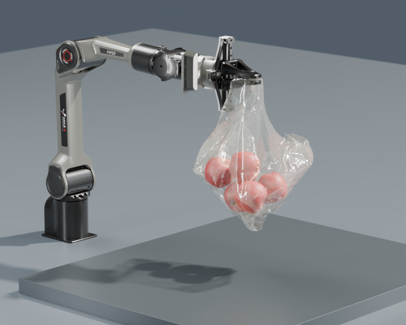

# Style3D Sim 使用文档

Style3D Sim 是面向 CUDA 的隐式物理求解库，通过 Python API 接入 Newton Physics。
这份文档从准备环境、构建扩展和登录账号开始，逐步讲解粒子、刚体、布料、软体和材质的使用。

公开仓库包含 Python 适配器、示例、文档和集成代码。
原生 `synreal-solver` 后端是闭源的，仅向获授权的内部开发人员开放；外部用户应从 `style3d-sim-bin` 安装匹配的预编译扩展。

## Demo 展示

<figure markdown="1">

<figcaption>G1 Jelly Drop · 刚体与四面体软体接触</figcaption>
</figure>
<figure markdown="1">

<figcaption>Piper Bag Transport · 机械臂操纵布料袋</figcaption>
</figure>

运行这些 demo 的方法见 [示例与渲染](guides/demos.md)。图片为离线渲染结果，实时 viewer 的外观可能不同。

## 从哪里开始

| 你的目标 | 阅读顺序 |
| --- | --- |
| 第一次使用库 | [安装](getting-started/installation.md)、[登录](getting-started/authentication.md)、[第一个仿真][first] |
| 已有 Newton 项目 | [仿真循环](guides/simulation-loop.md) → [刚体与关节](guides/rigid-bodies.md) |
| 做布料或软体 | [布料与四面体软体](guides/deformables.md) |
| 做流体、颗粒或断裂 | [粒子材质](guides/particles.md) |
| 调整速度与稳定性 | [参数与性能](guides/configuration.md) |
| 找接口签名 | [API 索引](reference/index.md) |

[first]: getting-started/first-simulation.md

## 先了解三个概念

**Newton 创建场景。** `ModelBuilder` 负责粒子、刚体、关节和碰撞形状；`model.state()` 创建状态缓冲区。

**Style3D Sim 推进物理。** `NewtonSolver.step()` 接受 Newton 状态、控制和接触数据，执行原生 CUDA 求解。

**Viewer 展示结果。** viewer 和离线渲染不替代物理求解。无需窗口时使用 headless 模式或独立仿真脚本。

!!! note "文档构建与仿真运行是两件事"
    文档站只依赖 Python 和 MkDocs，可以在普通 GitHub runner 上构建。
    运行求解器则需要兼容的 NVIDIA GPU、原生扩展和适用的登录凭据。

## 支持范围

常用入口包括粒子、四面体软体、Style3D 布料、仿射刚体、接触、关节驱动、粒子流体和黏结颗粒。
这不代表 Newton 的所有求解器特性都能直接映射到 Style3D Sim。
例如普通 Newton 三角形弹性需要改为 Style3D 属性，`requires_grad=True` 也不能当作原生求解器可微的保证。
遇到适配错误时先阅读对应教程，再查看 [常见问题](troubleshooting.md)。
