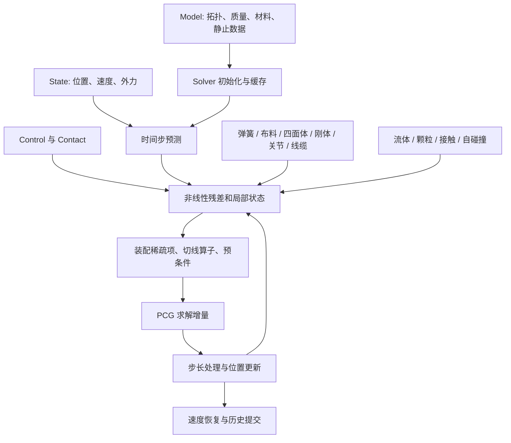

# Synreal / Style3D CUDA 仿真核心：算法流程、公式与实现原理

分析日期：2026-10-27。分析范围：当前 `_re_analysis/` 目录对应的 `_core.cpython-312-x86_64-linux-gnu.so`，以及提取的 PTX、机械还原代码、人工还原代码、API 反射和主机侧分析记录。

这是一份**实现导向的算法分析**：先解释系统在解什么问题，再把物理模型、离散公式、Newton/PCG、碰撞搜索与 GPU 数据结构接起来。它不是原始源码的逐行注释，也不把尚未完成的逆向工作包装成已经验证的结论。

配套文档：[全部 131 个自研 kernel 的签名、作用与代码入口](ALGORITHM_KERNEL_CATALOG_ZH.md)、[PTX 与代码验证报告](PTX_CODE_VERIFICATION_ZH.md)、[主机实参与字段对应](host/VERIFIED_ARGUMENTS_ZH.md)。附录逐项列出所有 kernel，包括模板特化，避免只介绍几个大模块而遗漏具体算子。

## 阅读导航

1. [证据等级与分析口径](#s1)
2. [系统架构、对象与自由度](#s2)
3. [单个时间步的算法流程](#s3)
4. [隐式积分与统一非线性方程](#s4)
5. [Newton、Gauss–Newton 与 PD-Newton](#s5)
6. [PCG、预条件与稀疏矩阵布局](#s6)
7. [距离弹簧](#s7)
8. [布料膜内伸长与剪切](#s8)
9. [布料四点弯曲与阻尼](#s9)
10. [四面体体积材料与应变阻尼](#s10)
11. [仿射刚体与 SO(3) 刚性约束](#s11)
12. [关节、驱动、硬距离与角度限位](#s12)
13. [接触、摩擦、表面接触与滚动阻力](#s13)
14. [自碰撞与 LBVH](#s14)
15. [流体密度约束、空间哈希与步长限制](#s15)
16. [颗粒接触、黏结、塑性与断裂](#s16)
17. [Cosserat 线缆与历史状态](#s17)
18. [空气阻力](#s18)
19. [GPU 实现、内存与复杂度](#s19)
20. [配置逐项说明](#s20)
21. [数值边界、指令语义与验证方法](#s21)
22. [一个时间步的公式串联与阅读路线](#s22)
23. [未确认事项与复现检查清单](#s23)

<a id="s1"></a>
## 1. 证据等级与分析口径

### 1.1 哪些内容能当作实现事实

本文使用以下标记，避免把数学常识、接口意图和二进制行为混为一谈。

| 标记 | 含义 | 使用范围 |
|---|---|---|
| **[直接]** | 已检查原始 PTX 及对应算术数据流 | 明确的更新公式、符号、系数、布局 |
| **[接口]** | `api_surface.txt` 的类型、字段或 docstring 明确说明 | 模型支持范围、参数单位、配置意图 |
| **[推导]** | 从已读出的力/算子推导其能量、梯度或矩阵形式 | 能量与切线解释；不等于原作者写过该能量表达式 |
| **[模型解释]** | 解释该模块的一般数学框架 | 复杂接触、线缆等未完整展开的分支 |
| **[未定]** | 缺少完整实参追踪、数据契约或运行验证 | 精确时序、部分 View 字段、全部分支的等价性 |

关键局部公式已通过直接运行二进制中提取的 PTX 进行 GPU 对照，验证方法、输入范围和结果见第 21、23 节。完整求解器的主机调度和端到端轨迹尚未完成运行验证。

### 1.2 实际模块数量

根据 `kernels.json` 过滤含 `synreal::` 且不含 `_kernel_agent` 的条目，并与 `recover/src/*/*.cu` 对照：

| 模块 | 自研 kernel 数 | 主要职责 |
|---|---:|---|
| `solver_newton` | **83** | 非线性步、弹性、仿射刚体、关节、接触、线缆、装配与预条件 |
| `pcg_solver` | **12** | 稀疏乘法、残差、搜索方向、解更新、归约 |
| `fluid` | **8** | 哈希网格、密度约束、Jacobian 行、步长控制 |
| `granular` | **8** | 颗粒接触、黏结、塑性、断裂、新键形成 |
| `self_collision` | **15** | 几何 AABB、候选查询、接触装配、切线作用 |
| `lbvh_builder` | **5** | Morton 编码、基数树、叶子映射、逃逸节点、AABB 回传 |
| 合计 | **131** | |

全部 CUDA entry 为 206，其中 131 个属于上述自研算法，另外 75 个为第三方/运行支持实例。

### 1.3 源文件与调用记录的使用方式

1. `kernels/` 中的原始 PTX 是设备侧实现的主要依据；`recover/src` 提供寄存器数据流阅读辅助，`recover/human` 和 `reconstructed` 提供局部可读表达。公式判断以 PTX 的实际运算类型、控制分支和内存访问为准。
2. `host/LAUNCH_ORDER.md` 给出 **call 指令地址顺序**。实际执行顺序还受跳转、回边和分支影响，需结合控制流图分析。
3. PCG 预条件分支使用 $r^TPr$ 类型的量。不同模板的标量数组角色须按各自的初始化、归约和更新入口确认。
4. 设备 kernel 直接计算 $\alpha$、$\beta$；主机 `cudaMemcpyAsync` 的用途与同步影响需要结合流、事件和后续依赖确认。
5. 指令识别、编译加载、数值一致、分支覆盖、整步轨迹分别是不同的证据层次，第 21 节给出验证口径。

<a id="s2"></a>
## 2. 系统架构、对象与自由度

### 2.1 系统的核心思想

这个核心把多类对象的运动写成一个位置/广义坐标更新问题。不同模块提供力、切线作用和预条件贡献，由 Newton 外迭代和 PCG 内迭代组织计算。

可将结构概括为：



这是**依赖关系图**，不是已经恢复的逐分支运行轨迹。

### 2.2 对外对象

| 对象 | 角色 | 需要注意的实现细节 |
|---|---|---|
| `Model` | 静态拓扑与物理参数 | 数组属性是非拥有型 CUDA 设备内存视图；调用方须保持分配有效 |
| `State` | 动态状态 | 包括粒子坐标、速度、力等；并非所有动态历史都在 State 中 |
| `Control` | 施加控制 | 广义力、目标及可选四面体体积激活等 |
| `Contact` | 外部接触数据 | 接触匹配、法线、局部点、材料/形状映射等；传入接触不意味着本库负责生成所有刚体碰撞 |
| `Config` | 求解配置 | 影响后续 step；已捕获 CUDA Graph 在配置改变后需要重新构建 |
| `Solver` | 内部缓存与历史的拥有者 | PCG 工作区、约束对偶、颗粒塑性历史、线缆罚参数等 |

依据：[API 反射](api_surface.txt)、[运行时布局](LAYOUT_RUNTIME.md)、[Contact 访问](CONTACT_USAGE.md)。

### 2.3 粒子与仿射刚体坐标

自由粒子坐标为 $x_i\in\mathbb R^3$。整体未知量可写为 $x\in\mathbb R^{3N}$，但其中的“三维条目”不一定都是物理空间里的独立质点。

仿射刚体的等价表示是：

$$
x(X)=t+A X,\qquad t\in\mathbb R^3,\ A\in\mathbb R^{3\times3}.
$$

一个仿射刚体因此有 12 个标量自由度。接口 `affine_body_indices` 明确提供四个 direct-ABD 坐标索引；SO(3) 力 kernel 对第一组三维坐标写零，对后三组施加矩阵列上的力，也支持“平移 + 三列仿射矩阵”的解释。

仿射坐标允许使用统一的三维向量数组和块矩阵乘法。刚性通过额外能量/约束实现，而不是在每一步把所有自由度直接限制成 6 维。

### 2.4 多世界批处理

大量 kernel 使用：

$$
b=\left\lfloor i/n_c\right\rfloor,\qquad k=i\bmod n_c,\qquad
\mathrm{offset}=b\,n_p.
$$

然后从第 $k$ 个模板约束读取局部索引，再加世界偏移。这里 $n_c$ 是每个世界的约束数，$n_p$ 是粒子/坐标步幅。

因此静态拓扑和材料可以在世界之间复用，动态位置分块存储。`particle_count` 与 `particle_state_count` 分别描述模板数量与动态状态总量；非复制模式还可能通过 `particle_world` 查询所属世界。不同 kernel 的三个 `size_t` 参数顺序并不统一，不能只凭名字猜其位置。

### 2.5 全文记号与单位

| 记号 | 含义 | 单位/约定 |
|---|---|---|
| $h$ | 物理时间步长 | 秒；与流体核半径 $h_f$ 区分 |
| $x_i,v_i$ | 自由粒子位置、速度 | 通常 m、m/s |
| $q$ | 通用广义坐标，或弯曲章节的局部向量 | 以所在章节定义为准 |
| $M$ | 质量/广义惯性矩阵 | 可含非对角项；ABD 平移与仿射列的量纲不同 |
| $P$ | 第 6 节为逆预条件器，第 10 节为应力矩阵 | 必须按章节区分，不能把应力矩阵当 PCG 预条件 |
| $J_c$ | 约束 Jacobian | 映射位移到残差变化 |
| $J=\det F$ | 第 10 节的体积比 | 标量，与 $J_c$ 区分 |
| $A$ | 线性系统矩阵或仿射变换矩阵 | 由所在公式的维数区分 |
| $A_0,A_e$ | 三角形/弯曲参考面积权重 | 通常 m²；精确调用实参仍需核对 |
| $s$ | 尚未完整追踪来源的标量形参 | 不因人工代码命名 `dt` 就擅自认定为 $h$ |
| $\mathcal H$ | 历史与局部状态集合 | 对偶、旋转、塑性长度、接触匹配、线缆状态等 |

对自由粒子，质量项和位置的量纲容易辨认；对仿射广义坐标，三个矩阵列可以是无量纲量，其广义质量块会吸收相应几何尺度。因而不能给所有三维数组条目无差别地赋予“粒子位置，单位 m”的物理解释。

<a id="s3"></a>
## 3. 单个时间步的算法流程

### 3.1 初始化阶段

从 API 和主机记录可确认，使用方式是先对配置好的 Model 调用 `initialize()`，再调用 `step()`。初始化至少涉及：

- 根据拓扑准备稀疏结构与内部设备缓冲；
- 缓存质量、预计算弹性或惯性项；
- 初始化颗粒键、约束历史及可用的模块状态；
- 预留接触、候选和 PCG 的工作空间。

主机侧记录能识别一批设备缓冲槽，但并未恢复完整的“成员名—长度公式—使用者”映射，不能把报告里所有成员偏移直接当作完整 Solver 类定义。

### 3.2 一个 step 的逻辑阶段

下面伪代码按数据依赖组织，**不是原始 C++ 控制流的逐行还原**。

```text
step(state_in, state_out, control, contact, h):
    建立活动自由度与惯性/外力预测
    初始化或刷新本步接触、约束、线缆和刚体局部状态
    按需要准备自碰撞几何与搜索结构

    对每次非线性迭代:
        在当前坐标上计算各物理模块的力/残差
        更新相应的接触/流体/颗粒局部线性化数据
        按配置装配稀疏块与预条件器
        构造当前线性算子 A 与右端 b
        用 Newton 或 PD-Newton 路径求增量 Δx
            内部使用 PCG 迭代
        流体场景执行步长缩放/上界限制
        x ← x + Δx，清零增量缓冲
        在相应的 primal 周期更新对偶/罚参数/局部旋转

    提交颗粒等不可逆历史
    根据惯性模式恢复速度
    写出状态
```

模块没有对应对象时可能跳过；不同求解分支可能改变装配和状态更新位置。“所有模块每步必执行一遍”不成立。

### 3.3 已直接确认的末端操作

`apply_nonlinear_step` 的计算是：

$$x_i^{out}=x_i^{in}+\Delta x_i,\qquad \Delta x_i\leftarrow0.$$

这个 kernel 本身没有能量比较或 Armijo 回溯逻辑。不能仅因其位于 Newton 循环尾部，就称项目实现了完整线搜索。

`update_velocity` 的局部计算是：

$$v_i=(b_i-a_i)s.$$

自由粒子路径通常对应 $s=1/h$。ABD 的惯性模式还涉及自身的速度构造/恢复，不能把这一条式子当作全部刚体分支的完整速度算法。

依据：[位置更新](recover/human/apply_nonlinear_step.cu)、[速度更新](recover/human/update_velocity.cu)、[主机调用记录](host/LAUNCH_ORDER.md)、[循环分析](host/STEP_STRUCTURE.md)。

<a id="s4"></a>
## 4. 隐式积分与统一非线性方程

### 4.1 自由粒子路径的基本离散化

记时间步长为 $h$，质量矩阵为 $M$，外力为 $f_{ext}$，弹性势能为 $E(x)$。隐式 Euler 的标准形式是：

$$
x_{n+1}=x_n+h v_{n+1},
$$

$$
M(v_{n+1}-v_n)=h\left[f_{ext}-\nabla E(x_{n+1})\right].
$$

消去速度得到：

$$
\frac{M}{h^2}(x_{n+1}-x_n-hv_n)-f_{ext}+\nabla E(x_{n+1})=0.
$$

对于可并入预测的恒定外力，可定义：

$$\hat x=x_n+h v_n+h^2M^{-1}f_{ext}.$$

如果只有重力，$M^{-1}f_{ext}=g$。`initialize_step` 的活动分支实际出现了：

$$\hat x_i=x_i+h v_i+h^2g_w,$$

并将预测写入状态/工作缓冲。它同时形成含 $1/h^2$ 的对角组合量。

### 4.2 增量势能

对保守力部分，可解释成最小化：

$$
\Phi(x)=\frac{1}{2h^2}(x-\hat x)^TM(x-\hat x)
+E_{elastic}(x)+E_{constraint}(x)+E_{contact}(x).
$$

这不是宣称所有摩擦、历史变量与阻尼都来自同一个全局光滑势能。对它们更稳妥的总表达是非线性残差：

$$R(x;\mathcal H)=0,$$

其中 $\mathcal H$ 包含固定在当前线性化中的历史、接触状态、旋转和对偶变量。

残差对应惯性平衡，切线对应 $\partial R/\partial x$ 或其稳定近似。力 kernel 常写 $-\nabla E$，而线性系统通常写 $A\Delta x=-R$；二者符号不同是表示约定，不是矛盾。

### 4.3 质量矩阵并非只能是对角阵

接口有 `particle_mass_non_diagonal_indices/values`，并且 `initialize_rhs`、惯性缓存刷新和稀疏组合都处理非对角项。因此不能把整个项目概括为只有逐粒子质量的显式质量-弹簧算法。

`initialize_rhs` 的可确认算术是：

$$
b_i=s\left[m_i(u_i-v_i)+\sum_j a_{ij}(u_j-v_j)\right]+b_i^{base}.
$$

`SolverNewton::step` 在主机上计算 $s=1/h^2$，并在 `0xfc4b5` 调用此入口。因此当前调用的右端为质量算子作用于两组位置差后乘 $1/h^2$，再加传入的 base。时间步的数据链见 [主机实参对应表](host/VERIFIED_ARGUMENTS_ZH.md)。

当 `max_nnz=0` 时，设备直接跳过稀疏部分，不读取行计数或非对角条目；质量索引仍使用模板周期，因此这个入口要求有效的非零 `tile`。它与允许 `tile=0` 的部分 PCG 矩阵乘入口具有不同契约。

质量不为正，或可选 flags 的最低位未置位时，该 kernel 写零右端。其他约束、运动学状态与固定自由度也必须保持一致处理。

依据：[initialize_step](recover/src/solver_newton/synreal__kernel__initialize_step.cu)、[initialize_rhs](recover/human/initialize_rhs.cu)。

<a id="s5"></a>
## 5. Newton、Gauss–Newton 与 PD-Newton

### 5.1 Newton 外迭代

在当前状态 $x^{(k)}$ 线性化：

$$A_k\Delta x_k=-R(x^{(k)}),\qquad x^{(k+1)}=x^{(k)}+\eta_k\Delta x_k.$$

对于势能问题，$R=\nabla\Phi$，$A=\nabla^2\Phi$。实际项目有精确切线、Gauss–Newton 块、冻结几何的切线以及模块级矩阵乘法；因此这里的 $A$ 不能默认等于所有项的完整精确 Hessian。

外迭代重新评估几何与非线性物理量，内层 PCG 在当前线性化下求一个近似增量。增加外迭代和增加 PCG 迭代解决的是不同误差：前者减少非线性线性化误差，后者减少当前线性系统误差。

### 5.2 Gauss–Newton 与稳定化切线

若一个约束的能量为：

$$E(x)=\frac12 c(x)^TWc(x),\qquad J=\frac{\partial c}{\partial x},$$

则：

$$\nabla E=J^TWc,$$

$$\nabla^2E=J^TWJ+\sum_a(Wc)_a\nabla^2c_a.$$

Gauss–Newton 保留：

$$H_{GN}=J^TWJ.$$

若 $W\succeq0$，则 $H_{GN}\succeq0$。被省略的第二项包含约束曲率，可能使系统不定。这个取舍有利于使用 CG/PCG，但并不自动证明整个混合系统始终正定。

项目使用多个名为 `add_*_gauss_newton_hessian` 的入口。具体矩阵必须按各入口的算术确定：普通弹簧和布料膜内两个入口包含截断横向刚度，并累加相对各向同性基准的矩阵增量，详见第 7、8 节。函数名本身不保证其输出就是完整的 $J^TWJ$。

### 5.3 装配矩阵与算子式计算并存

可以把线性算子写为：

$$Ap=A_{stored}p+\sum_m A_m p.$$

其中 $A_{stored}$ 是已存储的稀疏/块对角部分，$A_m p$ 由 `multiply_*_tangent`、`multiply_rows`、`multiply_contacts` 等局部算子提供。这解释了为什么同一物理模块通常同时出现“力”“预条件”“乘切线”三类 kernel。

不能把 `add_*_preconditioner` 等同于把该模块完整 Hessian 装入系统矩阵。预条件器可以只使用对角或对象内块，而实际 $Ap$ 仍保留耦合项。

### 5.4 PD-Newton 分支的确认边界

接口和主机符号确认存在 `NEWTON` 与 `PD_NEWTON` 两条路径，后者被接口称为 legacy。现有主机记录尚不足以给出其完整分裂公式、投影变量和缓存更新条件。

`solve_pd_newton_system` 的函数体已确认两种线性分派：布尔参数为 false 时使用标量 ELL、标量对角与标量逆预条件；为 true 时仍使用标量 ELL，但对角和逆预条件为 `mat3`，并构造 affine-body 预条件回调。`solve_newton_system` 则传入块 ELL 和 `mat3` 对角/逆预条件。具体对象偏移及调用地址见 [线性求解分派](host/VERIFIED_ARGUMENTS_ZH.md#4-newton-与-pd-newton-的线性求解分派)。

这些证据确认了存储和调用关系，尚不能把 PD 外层直接等同于某一种教科书 local-global 公式；其局部投影、缓存缩放和外层更新条件需要分别恢复。

<a id="s6"></a>
## 6. PCG、预条件与稀疏矩阵布局

### 6.1 统一记号

线性系统记为 $Az=b$。用 $P\approx A^{-1}$ 表示**逆预条件器**，避免与质量矩阵 $M$ 混淆。代码中某些参数也叫 `M`，实际执行的是逆预条件矩阵作用。

PCG 的数学迭代为：

$$r_0=b-Az_0,\quad w_0=Pr_0,\quad p_0=w_0,\quad \rho_0=r_0^Tw_0,$$

$$q_k=Ap_k,\qquad \alpha_k=\frac{\rho_k}{p_k^Tq_k},$$

$$z_{k+1}=z_k+\alpha_kp_k,\qquad r_{k+1}=r_k-\alpha_kq_k,$$

$$w_{k+1}=Pr_{k+1},\quad \rho_{k+1}=r_{k+1}^Tw_{k+1},$$

$$\beta_k=\frac{\rho_{k+1}}{\rho_k},\qquad p_{k+1}=w_{k+1}+\beta_kp_k.$$

$P=I$ 时，$\rho=r^Tr$；一般预条件分支采用 $\rho=r^TPr$。块预条件路径的融合 kernel 明确计算这一二次型。

### 6.2 实际 kernel 的分工

| 操作 | 对应实现 | 直接可见行为 |
|---|---|---|
| 残差 | `evaluate_residual<...>` | $r=b-Az$ |
| 矩阵乘法 | `multiply_matrix<...>` | 块对角 + ELL 稀疏项，部分入口还有额外向量项 |
| 预条件方向 | `update_cg_direction<float/mat3>` | $w_i=P_i r_i$，随后方向递推 |
| 另一方向入口 | `update_preconditioned_cg_direction` | 从传入向量直接递推；其名字不能代替输入语义分析 |
| 更新解与残差 | `update_solution_and_residual` | 从数组读标量比值，在 GPU 内更新 |
| 融合矩阵乘/归约 | `multiply_matrix_and_reduce` | 同时形成 $Ap$ 与块内 $p^TAp$ 部分和 |
| 融合更新/归约 | `update_solution_residual_and_reduce` | 更新后可选计算 $r^TPr$ |
| 初始化融合入口 | `initialize_zero_solution_and_reduce` | 复制一个向量、清零另一个向量，并计算输入的二次型；角色必须按调用点确认 |

源码入口：[方向更新](recover/human/update_cg_direction_blockjacobi.cu)、[融合更新](recover/human/update_solution_residual_and_reduce.cu)、[矩阵乘法](recover/human/multiply_matrix.cu)。

### 6.3 3×3 块 Jacobi 预条件

每个三维自由度对应一个局部块 $D_i$。装配完成后先做：

$$S_i=\frac12(D_i+D_i^T).$$

然后通过余子式计算 $S_i^{-1}$。对于对称矩阵：

$$S=\begin{bmatrix}a&b&c\\b&d&e\\c&e&f\end{bmatrix},$$

其第一行余子式为：

$$C_{00}=df-e^2,\quad C_{01}=ce-bf,\quad C_{02}=be-cd,$$

$$\det S=aC_{00}+bC_{01}+cC_{02}.$$

当 $\det S\le\tau$、行列式为 NaN，或 $|\det S|\ge+\infty$ 时，进入回退，其中 $\tau=\mathrm{float32}(10^{-30})$（位模式 `0x0DA24260`）：

$$P_i=\operatorname{diag}\left(a>0?1/a:0,\ d>0?1/d:0,\ f>0?1/f:0\right).$$

这是**对角倒数回退**，不是一般矩阵的 Moore–Penrose 伪逆。对称化加行列式阈值也不是严格的正定性检验；例如正行列式并不能排除两个负特征值。

依据：[块逆](recover/human/invert_block_preconditioner.cu)。另外存在 affine-body 级别的块预条件，可将一个身体内部多个三维自由度的耦合一起处理；完整块装配分支仍未全部还原。

### 6.4 ELL 与块 ELL

可读实现确认：

```cpp
struct NonZeroEntry      { int col; float val; };   // 8 bytes
struct BlockNonZeroEntry { int col; float m[9]; };  // 40 bytes
```

设每个模板有 $T$ 行，当前全局行 $i$ 的局部行号为 $r=i\bmod T$，世界/分块基址为 $b=i-r$。第 $e$ 个非零条目放在：

$$\mathrm{entries}[eT+r].$$

访问向量时用 $x_{b+col}$。这让同一 warp 中相邻行读取同一非零序号时，条目在内存中连续。

标量条目对应 $a_{ij}I_3$；块条目存一般 $3\times3$ 矩阵。矩阵乘法可统一写为：

$$y_i=D_ix_i+\sum_e B_{ie}x_{b+col_{ie}}.$$

必须同时检查 `row_nnz`、容量、列号和全局下标。所核对的标量 `multiply_matrix`、`evaluate_residual` 和块融合 `multiply_matrix_and_reduce` 均在 `max_nnz=0` 时跳过稀疏数组；`tile=0` 时使用局部行号 `i`，列号上界为零，所有非对角列都被排除。可选额外向量非空时加到矩阵乘结果上；残差入口再计算 `rhs−结果`。

`initialize_block_non_diagonal` 将标量条目扩成标量乘单位阵，输出总范围是 `group*max_nnz`。每个有效槽增加对应世界/分块列偏移，无效槽保留原值。浮点非对角分量在 PTX 中通过 `val*0` 构造，涉及 NaN 或无穷时不能简单等同于常量零。

惯性缓存刷新也区分空行与非空行：`refresh_inertial_cache_diagonals` 的空 CSR 行保留两个输出；`refresh_inertial_cache_nonzeros` 对两组 CSR 分别判断，哪一组为空就保留哪一组对应条目。仅用全零初始输出无法区分“保留”与“写零”，数值对照使用非零哨兵初值。

### 6.5 系统组合公式

`combine_system_non_diagonal` 的精确组合是：

$$out=e_0+s_0(e_1+s_1e_2+s_2e_3+s_3e_4+s_4e_5+s_5e_6).$$

列号复制自 $e_0$。它不是七个任意稀疏结构的合并器：参与数组的拓扑必须已对齐。各 $e_k$ 对应哪个物理缓存仍需主机实参确定。

### 6.6 迭代次数、归约和保护

默认配置为每个时间步 5 次非线性迭代、每次 50 次线性迭代。按完整执行默认循环估算，是约 250 次 PCG 迭代，**不是 250 次 kernel launch**；每次 PCG 内还有算子、向量更新和归约。

已分析的主机路径呈现按配置次数迭代，记录中未找到基于残差容差的浮点退出条件。该结论应限定于已检查路径，不能仅凭某个函数缺少浮点比较证明所有模板与异常分支都没有提前退出。

融合归约使用 warp shuffle、共享内存和块内归约，之后再汇总各块的部分和。模板中的 `256u` 与每块 8 个 warp 有关联；手工版本若写死 8 个 warp，就不能随意换 block 大小。

比值更新使用阈值 $\tau=\mathrm{float32}(10^{-30})$，位模式 `0x0DA24260` 对应约 $1.0000000031710769\times10^{-30}$。对分子 $a$、分母 $b$，更新系数可写为：

$$\operatorname{ratio}(a,b)=\begin{cases}
0,& |b|\le\tau\ \text{或}\ a,b\ \text{中有 NaN},\\
a/b,&\text{其他情况}.
\end{cases}$$

$\alpha$ 使用当前分子/分母，$\beta$ 在首轮取零，随后使用当前与上一轮分子之比。原 PTX 中“绝对值严格大于无穷”的 unordered 比较会拒绝 NaN，但无穷本身通过比较，因此这里并不是完整的有限性过滤；例如 $\infty/\infty$ 仍可能产生 NaN。该保护是绝对阈值，受问题的数值尺度影响。

<a id="s7"></a>
## 7. 距离弹簧

### 7.1 力的精确公式

对连接 $a,b$ 的弹簧，令：

$$d=x_b-x_a,\quad l=\|d\|,\quad n=d/l,\quad L=\text{rest length}.$$

`evaluate_spring_force` 计算：

$$f_a=k(d-Ln)=k(l-L)n,\qquad f_b=-f_a.$$

对应的能量为：

$$E_s=\frac12k(l-L)^2.$$

伸长时 $l>L$，$a$ 受到朝向 $b$ 的力；压缩时方向反转。两个端点分别进行三个分量的 `atomicAdd`，因此单根弹簧保持作用力与反作用力配对。

当长度不大于零时，代码使用零单位方向，避免直接除零。长度为零时的连续模型梯度本身有方向不唯一的问题；实现的零向量回退是一种离散选择，并非该点存在唯一光滑梯度。

### 7.2 精确 Hessian、稳定化矩阵与实际装配增量

对于相对位移 $d$，从弹簧能量求导得到：

$$K_s^{exact}=k\left[nn^T+\frac{l-L}{l}(I-nn^T)\right],\qquad l>0.$$

轴向特征值为 $k$，两个横向特征值均为 $k(1-L/l)$。压缩时横向特征值为负。若只做标准长度残差 Gauss–Newton，会得到 $K_s^{GN}=knn^T$。

**[直接]** `add_spring_gauss_newton_hessian` 对有限、合法输入且 $k>0,L>0$ 的弹簧采用以下矩阵：

$$Q(d,L)=\begin{cases}
I,&l\le10^{-8},\\
nn^T+t(I-nn^T),&l>10^{-8},
\end{cases}\qquad t=\max(0,1-L/l).$$

非退化情形下 $kQ$ 将精确 Hessian 的负横向特征值截为零；拉伸时保留正横向刚度，压缩时退化为轴向 GN 块。零长度附近采用 $Q=I$ 的独立回退。有限输入下，刚度或静止长度不大于零时，该入口直接跳过相应弹簧。其刚度检查使用 unordered 比较，静止长度及长度阈值检查使用 ordered 比较，因此不应把这些分支统一当作任意 NaN 输入的安全回退。

该 kernel **实际向输出数组累加**的是：

$$\Delta K_s=k(Q-I),\qquad
\Delta H_s=\begin{bmatrix}\Delta K_s&-\Delta K_s\\-\Delta K_s&\Delta K_s\end{bmatrix}.$$

两个对角块写入块对角数组，两个非对角块写入已有 ELL 拓扑中的对应列。它不在这里创建稀疏结构；列号与容量需要调用方预先准备。

若输入系统已经包含各向同性弹簧基准块

$$H_s^0=k\begin{bmatrix}I&-I\\-I&I\end{bmatrix},$$

则叠加结果为 $H_s^0+\Delta H_s=\begin{bmatrix}kQ&-kQ\\-kQ&kQ\end{bmatrix}$。这是由装配增量得到的条件式；完整求解路径中基准数组的来源和时间缩放仍须结合主机实参确认。直接把这个入口的输出当作完整刚度矩阵会遗漏基准项。

例如 $k=2,L=1,d=(2,0,0)$，有 $kQ=\operatorname{diag}(2,1,1)$，而实际累加的对角增量为 $\operatorname{diag}(0,-1,-1)$。当 $d=(0.5,0,0)$ 时，$kQ=\operatorname{diag}(2,0,0)$，增量为 $\operatorname{diag}(0,-2,-2)$。**增量自身不需要半正定**，需要考察的是最终系统矩阵。

原始 PTX 的 GPU 检查覆盖零长度、压缩、静止长度和拉伸四种输入，逐块比较了两个对角块和两个非对角块。

### 7.3 批处理索引

弹簧 kernel 明确从模板 `springs[slot]`、`k[slot]`、`rest[slot]` 读取数据，对位置索引加世界偏移。这意味着不同世界可共享弹簧静止长度与刚度，而位置和输出力属于各自的动态状态。

原始 ABI 的末三个参数依次为：总弹簧数、每个世界的弹簧数、每个世界的坐标步幅。全局弹簧编号先除以第二个计数得到世界编号，再按第三个步幅偏移位置索引。

依据：[逐条还原的弹簧力](reconstructed/evaluate_spring_force.cu)、[矩阵装配 PTX](kernels/solver_newton/012_add_spring_gauss_newton_hessian.ptx)。

<a id="s8"></a>
## 8. 布料膜内伸长与剪切

### 8.1 三角形上的两个材料方向

该实现不是仅在三角形边上放三根弹簧。`evaluate_stretch_force` 读取 `triangle_inv_dms`，从三角形的当前边构造两个材料方向。

为避免把 GLM 存储转置和数学记号混在一起，直接用代码读出的系数定义：

$$a=u_0x_0+u_1x_1+u_2x_2,\qquad b=v_0x_0+v_1x_1+v_2x_2,$$

$$u_0=-u_1-u_2,\qquad v_0=-v_1-v_2.$$

在 kernel 中，$u_1,u_2$ 来自单个 `mat2` 的字节偏移 0、8；$v_1,v_2$ 来自偏移 4、12。数学上它们是参考三角形形函数导数。把 $F=[a\ b]$ 看作从二维材料坐标到三维空间的变形梯度即可。

若用传统 $F=D_sD_m^{-1}$ 记号复现，必须先统一 `inverse_dm` 在本项目中的矩阵约定，不能直接将这四个内存数按自己的行列顺序填入。

### 8.2 三个残差

代码计算两个长度残差：

$$c_u=\|a\|-1,\qquad c_v=\|b\|-1.$$

剪切项使用归一化方向的点积，而非未归一化的 $a\cdot b$：

$$l_a^\epsilon=\sqrt{a\cdot a+\epsilon},\qquad l_b^\epsilon=\sqrt{b\cdot b+\epsilon},$$

$$\bar a=a/l_a^\epsilon,\quad\bar b=b/l_b^\epsilon,\qquad c_s=\bar a\cdot\bar b.$$

PTX 常数 `0x2B8CBCCC` 解码约为 $10^{-12}$。该常数在这里加在平方长度内部，不能理解成直接给长度加 $10^{-12}$。

经向/纬向的材料目标长度均为 1；剪切目标是归一化点积为 0，即材料方向正交。

### 8.3 可从力恢复出的能量

记 `triangle_aniso_stiffnesses` 的三个分量为 $k_u,k_v,k_s$，几何权重记为 $A_0$。可读出的力对应：

$$
E_{mem}=\frac{A_0}{2}\left[k_uc_u^2+k_vc_v^2+k_sc_s^2\right].
$$

接口将面积字段命名为 `triangle_rest_areas`，与该逐三角形标量权重的使用一致；完整主机实参追踪未完成时，以“几何权重 $A_0$”保留其调用层语义。

这三个参数控制不同方向的响应：$k_u\ne k_v$ 可以表达织物经纬向差异，$k_s$ 控制剪切角变化。对单位正交材料坐标，纯刚体旋转不会改变两个长度与点积，因此膜内能量对空间旋转不敏感。

### 8.4 梯度的具体表达

长度项在非退化处有：

$$\frac{\partial c_u}{\partial x_i}=u_i\frac{a}{\|a\|},\qquad
\frac{\partial c_v}{\partial x_i}=v_i\frac{b}{\|b\|}.$$

剪切项的两个方向导数为：

$$q_a=\frac{\bar b-c_s\bar a}{l_a^\epsilon},\qquad
q_b=\frac{\bar a-c_s\bar b}{l_b^\epsilon},$$

$$g_{s,i}=u_iq_a+v_iq_b.$$

于是逐顶点力是：

$$
f_i=-A_0\left[k_uc_u g_{u,i}+k_vc_v g_{v,i}+k_sc_s g_{s,i}\right].
$$

这与 `evaluate_stretch_force` 后半段的三组梯度、三种刚度加权、乘负几何权重、向三个顶点原子累加的结构一致。

### 8.5 膜内稳定化矩阵与装配增量

先从残差模型写出标准 Gauss–Newton 块，作为数学参照：

$$H_{ij}^{GN}=A_0\left[k_u g_{u,i}g_{u,j}^T+k_vg_{v,i}g_{v,j}^T+k_sg_{s,i}g_{s,j}^T\right].$$

**[直接]** `add_cloth_membrane_gauss_newton_hessian` 的长度项采用第 7 节的截断横向刚度形式。令：

$$Q_a=Q(a,1),\qquad Q_b=Q(b,1),$$

其中长度大于 $10^{-8}$ 时，$Q(a,1)=n_an_a^T+\max(0,1-1/\|a\|)(I-n_an_a^T)$；近零长度分支返回 $I$。剪切梯度仍为第 8.4 节含 $10^{-12}$ 平方长度正则项的 $g_{s,i}$。

稳定化局部块可写成：

$$\widehat H_{ij}=A_0\left[k_u u_i u_j Q_a+k_v v_i v_j Q_b+k_sg_{s,i}g_{s,j}^T\right].$$

该入口同时减去各向同性基准：

$$B_{ij}=A_0\left[(k_u+k_s)u_i u_j+(k_v+k_s)v_i v_j\right]I,$$

因此**输出累加值**是：

$$\boxed{\Delta H_{ij}=\widehat H_{ij}-B_{ij}}.$$

注意基准里也含剪切刚度 $k_s$，它同时进入 $u_i u_j$ 和 $v_i v_j$ 的系数。只根据长度能量写 $k_u u_i u_j I+k_v v_i v_j I$ 不能得到这个入口的实际增量。

若装配前已有 $B$，叠加后得到 $\widehat H$；这个条件关系并不代替对主机基准缓存和缩放系数的追踪。对合法几何权重、非负刚度及有限数据，$\widehat H$ 是半正定的：两个长度方向的 $Q$ 半正定，剪切部分是梯度外积。单独的 $\Delta H$ 不具有这一保证。

由于 $\sum_i u_i=\sum_i v_i=0$，局部模型对整体平移不变，三个顶点的内力之和为零；$\widehat H$、$B$ 与 $\Delta H$ 均应保留平移零空间。块矩阵满足 $H_{ji}=H_{ij}^T$，但某个非对角 $3\times3$ 块本身不一定对称。复现时需同时保持 ELL 列号和 GLM 列主序矩阵布局。

GPU 对照使用 12 组非退化三角形、非单位参考矩阵和三种非零各向异性系数，检查每组三个对角块与六个非对角块。完整退化几何、非法参考拓扑和所有容量分支未包含在这些样本中。

依据：[膜内力 PTX](kernels/solver_newton/041_evaluate_stretch_force.ptx)、[膜内矩阵装配 PTX](kernels/solver_newton/007_add_cloth_membrane_gauss_newton_hessian.ptx)、[材料字段](api_surface.txt)。

<a id="s9"></a>
## 9. 布料四点弯曲与阻尼

### 9.1 静止余切系数形成四点模板

接口明确说明 `edge_bending_cots` 是每条弯曲边的四个静止姿态余切系数。记为 $c_0,c_1,c_2,c_3$，四个顶点按 `edge_indices` 顺序记为 $x_0,x_1,x_2,x_3$。

从 `evaluate_bending_force` 可组合出：

$$w_0=-c_0-c_2,\quad w_1=-c_1-c_3,\quad w_2=c_2+c_3,\quad w_3=c_0+c_1.$$

显然 $\sum_iw_i=0$。定义离散弯曲向量：

$$q=\sum_{i=0}^{3}w_ix_i.$$

实际代码以相对 $x_0$ 的三条边线性组合构造 $q$，与上式相同。该表达避免显式求二面角、反三角函数及其导数。

### 9.2 弯曲能量、力与常量 Hessian

记相邻参考面积之和为 $A_e$，弯曲刚度为 $k_b$。代码中的缩放系数为 $3/A_e$，可对应：

$$E_b=\frac{3k_b}{2A_e}\|q\|^2,$$

$$f_i^{elastic}=-\frac{3k_b}{A_e}w_iq,$$

$$H_{ij}^{elastic}=\frac{3k_b}{A_e}w_iw_jI_3.$$

如果参考系数与拓扑固定，这一弹性项的 Hessian 不依赖当前位置，适合预计算并入稀疏缓存。这也解释了为什么当前 kernel 列表更突出单独的弯曲**阻尼**切线，而不是另设一个同名弹性弯曲切线。

“适合预计算”是由公式推导的结构性质；具体哪个缓存槽保存该项，还需主机实参确认。

### 9.3 弯曲阻尼是方向投影

令另一组输入位置生成 $q_{ref}$，标量形参记为 $s$。代码构造：

$$\dot q_{disc}=s(q-q_{ref}),\qquad n_q=q/\|q\|.$$

阻尼贡献为：

$$f_q^{damp}=-\frac{3k_d}{A_e}n_q(n_q^T\dot q_{disc}),$$

$$f_i=w_i\left[-\frac{3k_b}{A_e}q+f_q^{damp}\right].$$

主机 `0xfeaa8` 调用点明确传入 $s=1/h$，因此这里计算的是相对于另一组输入坐标的离散变化率 $(q-q_{ref})/h$。参考缓冲的完整生命周期仍须与状态管理一起解释。

这不是 $-k_d\dot q$ 的各向同性阻尼，而是沿当前弯曲向量方向的投影。冻结方向后，阻尼切线包含 $w_iw_jn_qn_q^T$。`multiply_bending_damping_tangent` 与 `add_bending_damping_preconditioner` 负责相应算子/对角块。

### 9.4 退化与不变量

代码检查部分无效索引、四个顶点重复、非正面积等条件；方向长度太小时采用零方向。索引的负值判定按 PTX 指令的有符号类型执行。

由 $\sum_iw_i=0$ 可知平移不变、弹性内力总和为零。由于能量含 $\|q\|^2$，整体旋转保持能量不变。这里的参考量是余切系数和面积；不能未经检查就再添加一个 `rest dihedral angle` 到这条已读出的公式中。

依据：[弯曲力 PTX](kernels/solver_newton/026_evaluate_bending_force.ptx)、[属性接口](api_surface.txt)。传入的逐边 `vec2` 两个分量分别表示刚度与阻尼系数。

<a id="s10"></a>
## 10. 四面体体积材料与应变阻尼

### 10.1 形函数梯度与变形梯度

四面体有四个节点。用参考形函数梯度 $g_i$ 表示：

$$F=\sum_{i=0}^{3}x_i g_i^T,\qquad \sum_i g_i=0.$$

等价的常见写法是 $F=D_sD_m^{-1}$，但复现时必须统一 `tetrahedron_inverse_dms` 的行列约定。该 kernel 的具体读取可写成：若原 `mat3` 九个连续 float 为 $B_0,\ldots,B_8$，则三个非基点的梯度是 $(B_0,B_1,B_2)$、$(B_3,B_4,B_5)$、$(B_6,B_7,B_8)$，基点梯度为三者之和取负。

令 $J=\det F$。代码通过交叉乘积/余子式计算 $\operatorname{cof}F$，无需在此力公式中直接求 $F^{-1}$。

### 10.2 实际读出的弹性应力

材料参数来自 `tetrahedron_materials`，接口称其为 $(k_\mu,k_\lambda,k_{damp})$。记：

$$\mu=k_\mu,\qquad K=k_\mu+k_\lambda.$$

对正常 $K>0$ 分支，代码设置：

$$J_*=1+\frac{\mu}{K}.$$

可选体积激活量为 $a$，未提供激活数组时 $a=0$。弹性一阶 Piola 型矩阵为：

$$P(F)=\mu F+K(J-J_*+a)\operatorname{cof}F.$$

若 $K\le0$，代码把 $J_*$ 置为 1，不能继续使用上面的除法表达。

由这一应力可积分出一个等价的弹性能量密度：

$$\psi(F)=\frac{\mu}{2}\|F\|_F^2+\frac K2(J-J_*+a)^2+\mathrm{const}.$$

它是关于 $F$ 与 $\det F$ 的多项式形式；不要未经核对换成带 $\log J$ 的另一种材料公式。这样会改变翻转、强压缩以及体积激活时的行为。

### 10.3 为什么 $J_*$ 不直接等于 1

当 $F=I,a=0,K>0$：

$$P(I)=\mu I+K\left(1-1-\mu/K\right)I=0.$$

偏移 $\mu/K$ 正好抵消第一项在静止构型产生的应力。因此 $J_*$ 不是“模型希望静止体积变成 $1+\mu/K$”的简单目标，而是整个能量组合达到静止无应力所需的偏移。

### 10.4 节点力与精确方向导数

设 kernel 传入的逐单元几何权重为 $w_t$，则弹性节点力为：

$$f_i=-w_t P g_i.$$

标准有限元中 $w_t$ 通常是参考体积；本目录尚缺完整主机实参映射，因此这里保留“几何权重”的名称。

对扰动 $\delta F=\sum_i\delta x_i g_i^T$，有：

$$\delta J=\operatorname{cof}F:\delta F,$$

$$\delta P=\mu\delta F+K\left[(\delta J)\operatorname{cof}F+(J-J_*+a)\,\delta(\operatorname{cof}F)\right].$$

若 $F=[f_1\ f_2\ f_3]$，余子式列为 $f_2\times f_3,f_3\times f_1,f_1\times f_2$，例如：

$$\delta(f_2\times f_3)=\delta f_2\times f_3+f_2\times\delta f_3.$$

这给出无需显式形成 $12\times12$ 矩阵的切线乘法。项目有 `multiply_tetrahedron_tangent`；完整实现是否对某些项采用稳定化，需要逐分支比对此式，不能只凭函数名称为“精确 Hessian”。

### 10.5 应变变化阻尼

该 kernel 还从另一组坐标构造 $F_{ref}$，计算：

$$C=F^TF,\qquad C_{ref}=F_{ref}^TF_{ref},\qquad Q=s(C-C_{ref}).$$

代码中对称张量的非对角分量出现两倍权重，对应 Frobenius 内积对上下三角的共同贡献。对节点梯度 $g_i$，其收缩结构可写为：

$$f_i^{damp}=-2w_tk_{damp}FQg_i.$$

主机 `0xfeba7` 调用点明确传入 $s=1/h$，所以 $Q=(C-C_{ref})/h$，即相对于参考坐标所形成张量的离散变化率。

纯刚体旋转满足 $F^TF$ 不变，因此这类阻尼不会像直接对世界速度施加粘性那样阻碍整体旋转。非正阻尼参数时有跳过分支。

依据：[四面体力](recover/src/solver_newton/synreal__kernel__evaluate_tetrahedron_force.cu)、[四面体切线](recover/src/solver_newton/synreal__kernel__multiply_tetrahedron_tangent.cu)、[对角预条件](recover/src/solver_newton/synreal__kernel__add_tetrahedron_preconditioner.cu)。

<a id="s11"></a>
## 11. 仿射刚体与 SO(3) 刚性约束

### 11.1 仿射映射为什么适合统一求解

对 body-local 点 $X$，$x=t+AX$ 对 12 维仿射坐标是线性的。其 Jacobian 为一个由常数 $1,X_x,X_y,X_z$ 组成的 $3\times12$ 矩阵 $J_X$。

空间力与切线可以映射回广义坐标：

$$f_q=J_X^Tf_x,\qquad H_q=J_X^TH_xJ_X.$$

连接两个仿射体的弹簧、接触和点线约束因此可统一通过局部点位置与插值权重组装。该映射也会产生同一刚体四组三维坐标之间的非对角块，解释了 body 级预条件的必要性。

### 11.2 四种刚性模型的边界

接口列出：`CO_ROTATED`、`ABD_ORTHOGONALITY`、`SIX_SPRINGS`、`SO3_AUGMENTED_LAGRANGIAN`。默认是最后一种。

作为模型解释，正交性约束常写 $A^TA-I=0$，共旋模型通过局部旋转 $R$ 衡量 $A$ 的变形，六弹簧模型通过若干方向长度约束抑制形变。但本文没有把其他三个分支的全部系数和投影过程恢复出来，因此这些说明不替代它们的精确实现。

### 11.3 SO(3) 力 kernel 的具体投影

SO(3) 力采用固定参考旋转下的对称投影形式。设局部旋转/正交参考为 $R$，另一矩阵状态为 $U$，定义：

$$B=A-R+U,$$

$$\operatorname{sym}(Z)=\frac12(Z+Z^T),\qquad
\mathcal P_R(B)=R\operatorname{sym}(R^TB).$$

`evaluate_affine_body_so3_augmented_lagrangian_force` 的九个仿射分量对应：

$$f_A=-\kappa\mathcal P_R(A-R+U).$$

其中 $\kappa$ 是逐 body 标量与函数标量形参的乘积；平移坐标的该项贡献为零。

这可以从“先与 $R$ 的列做点积，合并对称分量，再乘回 $R$，最后乘负系数”的数据流直接辨认。`U` 的物理解释与其是否已缩放仍需结合状态更新；这里不擅自称其为未缩放的拉格朗日乘子 $\lambda$。

### 11.4 冻结旋转后的切线

对应切线 kernel 计算：

$$\delta A\longmapsto\kappa\mathcal P_R(\delta A).$$

当 $R$ 正交时，$\mathcal P_R$ 是投影到共旋坐标系中对称变形方向的算子：

$$\langle\delta A,\mathcal P_R(\delta A)\rangle
=\|\operatorname{sym}(R^T\delta A)\|_F^2\ge0.$$

若 $\delta A=R\Omega$ 且 $\Omega^T=-\Omega$，则该切线为零。这说明冻结局部状态后，它主要惩罚拉伸/剪切方向，保留瞬时旋转方向。

在固定 $R,U$ 下，可对应二次能量：

$$E_R=\frac\kappa2\|\operatorname{sym}(R^T(A-R+U))\|_F^2.$$

这是从 kernel 推导的局部能量，不意味着更新 $R,U$ 后仍在优化完全相同的二次函数。

### 11.5 局部旋转更新与惯性模式

`initialize_affine_body_so3_state`、`update_affine_body_so3_augmented_lagrangian_state` 包含归一化、交叉乘积、方向调整与退化回退。现有代码不支持直接断言其就是一次标准 SVD 极分解；需要继续恢复全部分支才能命名精确投影算法。

更新周期由 `affine_body_rigidity_primal_iterations` 控制，含义是固定 SO(3) AL 状态进行若干 primal Newton 迭代，再更新局部状态。

惯性模式独立于刚性材料模型，接口提供 `EXPLICIT_EULER`、`IMPLICIT_EULER`、`LIE_GROUP_MIDPOINT`、`MIDPOINT_CAYLEY`、`NONE`、`VBD_SEMI_IMPLICIT`。默认 `MIDPOINT_CAYLEY` 描述 ABD 惯性构造/速度恢复；它不等于整个多物理求解器全部使用同一种中点时间离散。

对于 Cayley 方法的数学背景，常用旋转增量是 $(I-\Omega/2)^{-1}(I+\Omega/2)$，$\Omega$ 为反对称角增量矩阵。**该式在此仅解释枚举名，不作为已恢复的主机实现公式。**

依据：[SO(3) 力](recover/src/solver_newton/synreal__kernel__evaluate_affine_body_so3_augmented_lagrangian_force.cu)、[SO(3) 切线](recover/src/solver_newton/synreal__kernel__multiply_affine_body_so3_augmented_lagrangian_tangent.cu)、[SO(3) 状态更新](recover/src/solver_newton/synreal__kernel__update_affine_body_so3_augmented_lagrangian_state.cu)。

<a id="s12"></a>
## 12. 关节、驱动、硬距离与角度限位

### 12.1 罚函数与增广拉格朗日的统一解释

对等式约束 $c(q)=0$，罚函数形式为：

$$E_{pen}=\frac\kappa2\|c(q)\|^2.$$

增广拉格朗日的解释形式为：

$$\mathcal L(q,\lambda)=E(q)+\lambda^Tc(q)+\frac\kappa2\|c(q)\|^2,$$

$$g_c=J_c^T(\lambda+\kappa c),\qquad H_c^{GN}=\kappa J_c^TJ_c,$$

$$\lambda^{new}=\lambda+\kappa c(q^{new}).$$

实际程序可存缩放对偶 $u=\lambda/\kappa$，并可能引入质量归一化、更新周期、投影和历史衰减。因此上面是解释框架，不是各个 `update_*_state` 的逐指令替代。

AL 的目的在于让累积的约束反力帮助减少误差，而不是只靠无限增大罚刚度。罚刚度过大会恶化线性系统条件数；即使使用 AL，有限迭代下也不意味着约束误差必为零。

### 12.2 点到点与硬距离

两个 body-local 点变换到世界后记为 $p_a(q),p_b(q)$。距离残差可写：

$$c_d=\|p_a-p_b\|-L.$$

其空间梯度为 $n$ 和 $-n$，再用 body 点的 Jacobian 映射到仿射坐标。项目区分普通 body spring、joint-generated spring 与 hard distance constraint；它们可能共享几何，但状态管理、罚参数与约束方式不同。

硬距离具有 `initialize_body_distance_constraint_state`、`evaluate_body_distance_constraint_force`、`update_body_distance_constraint_state` 三段生命周期，并有逐约束 mass scale。

### 12.3 点到线段

几何原理是找点 $p$ 在端点 $a,b$ 定义线段上的最近点：

$$t=\operatorname{clamp}\left(\frac{(p-a)^T(b-a)}{\|b-a\|^2},0,1\right),\qquad
r=p-[a+t(b-a)].$$

这是接口“point-to-line-segment”含义对应的几何公式。端点区域、零长度线段、是否冻结投影参数 $t$、是否对 $t$ 求导会改变切线；不同 force/GN/AL kernel 的精确取舍尚未逐分支展开，不能一律假设相同。

### 12.4 驱动、角度历史与限位

接口支持目标位置、目标模式、刚度、阻尼、广义力/速度坐标和 effort limit。一个典型驱动解释式是：

$$\tau=\operatorname{clip}\left[k_p(q_{target}-q)+k_d(v_{target}-\dot q),-\tau_{max},\tau_{max}\right].$$

具体 target mode 的公式、某些通道是否使用目标速度，必须查对应分支；本文不把这个示例当作所有驱动模式的精确公式。

`update_joint_drive_angle_state` 表明角驱动保留角度状态，可能用于跨周期的连续角度解释；确切 unwrap 与重置条件需进一步核对。`reset_selected_joint_drive_state` 的直接行为是按掩码清零。

角度限位可以通过下/上界的单边残差理解：

$$c_l=\min(q-q_{min},0),\qquad c_u=\max(q-q_{max},0).$$

限位刚度、阻尼、激活方向和切线由 `evaluate_angular_limits` 处理，不能把不等式限位当作始终开启的双边弹簧。

### 12.5 关节 armature

`joint_armature` 表示关节 DOF 的反射惯量。若广义速度为 $\dot q=J_v v$，额外动能的解释是：

$$T_a=\frac12(J_vv)^TM_a(J_vv),\qquad M_{eff}=J_v^TM_aJ_v.$$

因此 armature 改变的是有效惯性，不是另一种位置弹性。项目单独有 `initialize_joint_coordinate_velocities` 与 `evaluate_joint_armature`，说明其计算依赖关节速度映射。

相关入口全部列在 [kernel 附录](ALGORITHM_KERNEL_CATALOG_ZH.md)。

<a id="s13"></a>
## 13. 接触、摩擦、表面接触与滚动阻力

### 13.1 接触几何与单边性

采用“分离距离为正”的解释约定，记法向间隙为 $g(q)$，不穿透条件是：

$$g\ge0,\qquad \lambda_n\ge0,\qquad \lambda_n g=0.$$

这里 $\lambda_n$ 是压缩方向接触反力大小。代码内部法线方向与距离符号可能采用相反约定，因此复现时应先用一个两物体相向运动的简单场景确认符号。

普通罚接触的解释能量为：

$$E_n=\frac{k_n}{2}\min(g,0)^2.$$

冻结法线和接触插值后，其 GN 型切线是：

$$H_n=k_nJ_g^TJ_g.$$

完整切线还可能含距离/法线随位置变化的二阶项，或采用截断、冻结几何与阻尼贡献。项目分别有普通接触、soft contact、surface contact、hard contact 的路径，不能只用一个标量弹簧公式覆盖所有分支。

### 13.2 硬接触的生命周期

接口明确说明 `rigid_contact_hard=True` 使用法向增广拉格朗日与基于位移的 Coulomb 摩擦。相关入口为：

```text
initialize_hard_contacts
    → evaluate_hard_contacts
    → update_hard_contact_duals
    → snapshot_hard_contacts / 历史匹配
```

这是功能依赖顺序，具体 snapshot 位于何次循环由主机分支决定。

采用上述间隙约定，一个投影 AL 更新的解释式为：

$$\lambda_n^{new}=\max(0,\lambda_n-\kappa g).$$

程序还具有 C0 稳定化参数 `alpha`、罚参数递增 `beta`、历史衰减 `gamma`、初始刚度与接触匹配。**本次没有恢复这几个参数在每个硬接触分支的精确组合式**，上面的公式只用于解释“单边投影 + 对偶积累”。

### 13.3 摩擦圆盘与滑动切线

令 $n$ 为单位法线，切向投影为：

$$P_t=I-nn^T.$$

切向相对速度/位移经过 $P_t$ 投影。Coulomb 约束是：

$$\|\lambda_t\|\le\mu\lambda_n.$$

常见的试算再投影可以写成：

$$\lambda_t^{trial}=\lambda_t^{old}-k_t\Delta u_t,$$

$$\lambda_t=\Pi_{\|z\|\le\mu\lambda_n}(\lambda_t^{trial}).$$

如果试算值在圆盘内部，则处于粘着区；超出圆盘时进入滑动区并限制摩擦大小。这与接口所述位移摩擦相符，但程序精确的历史、符号和增量定义仍需按 kernel 核对。

接口 `rigid_contact_sliding_tangent` 明确表示是否在固定法向载荷下对 Coulomb disk 求导。对固定半径 $R$ 的圆盘投影，滑动区 $\|z\|>R$ 的导数是：

$$D\Pi(z)=\frac R{\|z\|}\left(I-\hat z\hat z^T\right).$$

这解释了该开关为什么会改变线性算子，而不仅仅改变摩擦力大小。默认 `False` 保留旧切线；不能假设开启后就是对包括法向载荷变化在内的全部摩擦模型求完整导数。

`rigid_contact_friction_epsilon` 的单位为 m/s，用于摩擦速度平滑；零值保留 native secant law。由于具体平滑函数尚未读完，本文不擅自替换为 $\sqrt{v^2+\epsilon^2}$ 或其他常见函数。

### 13.4 接触的非对角块与预条件块

对于两个自由点的相对位移，冻结几何的局部切线常有：

$$H_{pair}=\begin{bmatrix}K&-K\\-K&K\end{bmatrix}.$$

两个对角块与两个非对角块共同决定相对运动。只保留对角块会弱化耦合，改变迭代性质。

`enable_collision_hessian_non_diagonal` 控制 rigid、particle-shape、自碰撞的耦合切线是否纳入；接口明确说 full-surface 与 angular-friction 切线保持耦合。`affine_body_contact_block_preconditioner` 则控制**预条件器**中接触交叉项的纳入，接口说明它不改变接触算子本身。两个开关不能混同。

### 13.5 full-surface 与滚动/扭转阻力

surface 接触具有独立的 force、tangent、preconditioner 和 stiffness-scale kernel，表明它使用比一个简单点对法向弹簧更复杂的几何与材料权重。精确接触面采样和权重定义未完整恢复，应查其 View 的数据契约后再推导。

滚动/扭转摩擦使用相对角速度：

$$\omega_t=(I-nn^T)\omega_{rel},\qquad \omega_n=n^T\omega_{rel}.$$

前者对应切平面内的滚动，后者对应绕接触法线的自旋。接口提供 `shape_rolling_frictions`、`shape_torsional_frictions` 和正的角速度正则化量，单位 rad/s。相应反扭矩通过 body 的角速度/仿射坐标映射参与力和切线。

这一节给出的是角分解与模块作用。精确载荷、有效半径、截断和平滑函数不能由参数名唯一确定，本文未把它们写成已确认公式。

### 13.6 碰撞能力不能过度推断

存在接触力、自碰撞查询和防解缠项，并不自动意味着有连续碰撞检测、严格无穿透保证、IPC barrier 或全局可行线搜索。本次未找到足以确认这些保证的完整链路。默认还关闭了自碰撞与硬刚体接触。

依据：[接触接口](api_surface.txt)、[接触字段访问](CONTACT_USAGE.md)、`recover/src/solver_newton/*contact*.cu`。

<a id="s14"></a>
## 14. 自碰撞与 LBVH

### 14.1 搜索与响应是两层算法

LBVH 负责缩小可能相交的几何组合；自碰撞 narrow phase 负责具体距离/相交关系；接触力与切线负责物理响应。BVH 本身不决定接触刚度和摩擦模型。

相关 primitive 包括粒子、边、三角形。自碰撞查询/装配有四类：vertex-face、edge-edge、particle-particle、edge-face。edge-face 接口配置指向 untangling penalty，不能与普通 edge-edge 距离项完全混同。

### 14.2 AABB 构建

对半径为 $r$ 的点：

$$b_{min}=x-r\mathbf1,\qquad b_{max}=x+r\mathbf1.$$

对一条边或一个三角形，先逐坐标求顶点的最小/最大值，再按厚度向两侧扩展。

可读 `build_edge_aabbs` 显示四元边拓扑的 **.z/.w** 才是该处用于包围盒的两个端点，不能误用 .x/.y。弯曲四点顺序与碰撞边端点顺序也不能无条件当成相同含义。

### 14.3 Morton 编码

`generate_morton_codes` 将 primitive 中心相对场景 AABB 归一化到 $[0,1)$。每个轴乘 1024 再转整数，即每轴约 10 bit、组合约 30 bit。

设量化坐标为 $q_x,q_y,q_z$，Morton 码通过各轴二进制位交错构成。其作用是将三维邻近性大致映射成一维排序邻近性，不保证欧氏距离单调。

归一化轴长度非正时有回退；归一化值夹在 0 与小于 1 的最大 float 之间，避免产生 1024 这个超出十位编码范围的端点。

### 14.4 基数树构建

排序后的 Morton 码用于构造二叉 radix tree。`build_radix_tree` 中的 `clz` 对应公共前缀长度：

$$\delta(i,j)=\operatorname{clz}(m_i\oplus m_j).$$

若码相同，需要进一步利用索引区别。根据与两侧公共前缀长度的差异选择范围方向，再搜索区间与分割位置。节点的具体数组编号、同码 tie-break 和边界处理以 PTX 为准。

`build_primitive_leaf_nodes` 的直接映射是：

$$leaf[primitive\_id_i]=i+N-1.$$

这是常见的“前 $N-1$ 个槽放内部节点、之后放叶子”的数组布局，**不是仅凭该式就能称为一基堆或推导孩子为 $2i,2i+1$ 的堆布局**。

### 14.5 AABB 回传与 escape 节点

内部节点的盒子是子节点盒子的并集：

$$B_{parent}=B_{left}\cup B_{right}.$$

`refit_aabbs` / `refit_bvh` 用当前几何刷新包围盒。refit 通常不改变树拓扑；但何时重新排序重建，必须看主机调度，不能仅由函数列表判断每步都重建。

`build_escape_nodes` 的明确逻辑是：从当前节点沿父链上升，跳过“当前节点是父的右子”的情况，找到第一个可以转向右兄弟的位置；找不到则返回 -1。

这样 traversal 可在某节点不相交或子树处理完时直接跳到 escape，无需保存完整递归栈。

粒子盒和边盒入口的最后三个整型实参依次为总数 `n`、每世界拓扑数 `tile`、每世界坐标步幅 `stride`。输入索引和半径可以按模板共享，而坐标必须增加世界偏移。`multiply_hessian_diagonal` 执行 `out += H*p`，会保留其他模块已积累的向量贡献。

### 14.6 narrow phase 与局部约束

点-面接触可用最近点重心坐标表示：

$$d=x_p-(\beta_0x_0+\beta_1x_1+\beta_2x_2),\qquad \sum_i\beta_i=1.$$

边-边接触可写：

$$d=(1-s)x_a+s x_b-[(1-t)x_c+t x_d],\qquad s,t\in[0,1].$$

冻结最近点权重和法线时，约束梯度为“插值权重 × 法线”，GN 块是这些梯度外积。完整分区切换、共拓扑过滤、退化边/面与解缠符号需检查对应 query/accumulate 分支；本文不声称上面的距离模型已穷尽 edge-face 的解缠行为。

`multiply_contact_tangents` 和对角 Hessian 的 add/multiply 入口，使自碰撞可以作为局部线性算子接入 PCG。

依据：[粒子盒](recover/human/build_particle_aabbs.cu)、[边盒](recover/human/build_edge_aabbs.cu)、[escape](recover/human/build_escape_nodes.cu)、[Morton PTX](kernels/lbvh_builder/004_generate_morton_codes.ptx)。

<a id="s15"></a>
## 15. 流体密度约束、空间哈希与步长限制

### 15.1 模块链路

八个流体 kernel 的功能依赖为：

```text
build_grid → evaluate_rows → accumulate_rows / multiply_rows / add_diagonal
                               ↓
                 initialize_scale → bound_scale → scale_step
```

它不是“先单独求一个传统压力 Poisson 方程”的唯一可能架构。这里可见的是密度约束残差、Jacobian 行、力/预条件积累及矩阵作用，并作为 Newton 系统的一部分工作。

### 15.2 空间哈希网格

网格边长来自 `fluid_smoothing_radius`，记为 $h_f$。网格坐标为：

$$c=\left\lfloor x/h_f\right\rfloor.$$

PTX 使用向负无穷取整。坐标为负时，floor 与向零截断不同，这是复现时的关键细节。

哈希函数的实际常数为：

$$H(c)=\big[(c_x\cdot73856093)\oplus(c_y\cdot19349663)\oplus(c_z\cdot83492791)\big]\ \&\ (S-1).$$

此处使用位掩码；若希望它等价于对槽数取模，需要 $S$ 为适当的二次幂。槽中通过原子交换插入链表头，将旧头写成该元素的 `next`。

查询枚举周围 $3^3=27$ 个网格。哈希碰撞之后还要验证实际网格坐标；不能把同一个哈希槽的全部元素当成同一格子。还要检查世界编号，避免不同世界粒子相互作用。

### 15.3 流体粒子与固定边界的统一体积权重

`build_grid` 对流体粒子计算：

$$V_j=m_j/\rho_0.$$

固定边界采样点使用接口提供的 `fluid_boundary_volumes`。它们是固定位置的体积积分采样点，接口明确说不是 collision shape。

因此密度估计可写成归一化量：

$$\bar\rho_i=\sum_j V_jW(x_i-x_j).$$

该表达包含流体粒子和相容的边界采样点。边界提供密度贡献，但不能像动态粒子一样分配未知位移。

### 15.4 实际核函数：poly6 形式

从 `evaluate_rows` 的常数与乘法链可确认：

$$W(r)=\frac{315}{64\pi h_f^3}\left[\max\left(1-\frac{\|r\|^2}{h_f^2},0\right)\right]^3.$$

记 $z=\max(1-\|r\|^2/h_f^2,0)$，其内部梯度是：

$$\nabla W(r)=-\frac{945}{32\pi h_f^5}z^2r.$$

PTX 常数解码为 1.566681385… 和 -9.400088310…，分别匹配 $315/(64\pi)$ 与 $-945/(32\pi)$ 的 float 近似。

### 15.5 只对过密激活的残差

`evaluate_rows` 最终写入：

$$c_i=\max(\bar\rho_i-1,0).$$

因此这条密度项主要抑制过度压缩；在欠密区域不会以同一项继续产生对称的拉回力。不能将它解释成无条件的 $(\bar\rho_i-1)^2$ 双边约束。

令 $a_i$ 为网格点 $i$ 对应的物理粒子编号。活动区的 Jacobian 为：

$$J_{i,a_i}=\sum_{j\ne i}V_j\nabla W(x_i-x_j),\qquad J_{i,a_j}=-V_j\nabla W(x_i-x_j).$$

中心项的和包含相容边界采样点；第二式只对动态邻居成立。世界编号等于当前世界或为 `-1` 的采样点可参与查询；物理粒子编号为负的边界不进入动态邻居缓存，不接收力、矩阵乘输出或自由度。

每行活动权重为：

$$k_i=\begin{cases}K V_i,&\bar\rho_i>1,\\0,&\bar\rho_i\le1.\end{cases}$$

$K$ 来自 `fluid_bulk_modulus`。残差、中心梯度和权重按流体行编号存储，邻居缓存存的是**网格点编号**；写入最终力和矩阵输出前，必须再通过 `particle_ids` 映射到物理粒子编号。

### 15.6 行式 GN 装配

用 $J_i$ 表示一个密度残差的稀疏 Jacobian 行，$k_i$ 表示活动权重。`accumulate_rows` 的结构对应：

$$f\mathrel{+}=-k_i c_iJ_i^T,$$

$$D_j\mathrel{+}=k_iJ_{ij}^TJ_{ij}.$$

矩阵作用可以按两步完成：

$$s_i=J_ip,\qquad y\mathrel{+}=k_iJ_i^Ts_i.$$

这样无需把该约束涉及的所有邻居两两耦合块都显式存入大稀疏矩阵。它仍然表示耦合算子 $J_i^Tk_iJ_i$，并不是只保留了对角项。

#### 15.6.1 邻居配对黏性项

记 $r_{ij}=x_i-x_j$，时间步为 $h$，平滑半径为 $h_f$，黏性系数为 $\mu$。对于支撑半径内的动态邻居，只有网格编号 $j>i$ 的一侧生成非零配对系数，避免重复装配：

$$\nu_{ij}=\frac{-2\mu V_iV_j\,[r_{ij}\cdot\nabla W(r_{ij})]}{(\|r_{ij}\|^2+0.01h_f^2)h}.$$

当 $\mu\le0$ 或不满足配对方向时，缓存标量为零。正常正体积、正时间步下，$r\cdot\nabla W\le0$，因而 $\nu_{ij}\ge0$。缓存 `vec4.xyz` 为 $-V_j\nabla W$，`vec4.w` 为 $\nu_{ij}$。主机将 `fluid_viscosity` 和时间步分别放入 View 的 `+104` 和 `+108` 字节位置，明确了系数中的时间缩放。

令 $y$ 为 `accumulate_rows` 的参考坐标实参，定义相对位移差：

$$d_{ij}=(x_{a_i}-x_{a_j})-(y_{a_i}-y_{a_j}).$$

则黏性对力、对角块和矩阵作用的贡献分别是：

$$f_{a_i}\mathrel{+}=-\nu_{ij}d_{ij},\qquad f_{a_j}\mathrel{+}=\nu_{ij}d_{ij},$$

$$D_{a_i}\mathrel{+}=\nu_{ij}I_3,\qquad D_{a_j}\mathrel{+}=\nu_{ij}I_3,$$

$$(Ap)_{a_i}\mathrel{+}=\nu_{ij}(p_{a_i}-p_{a_j}),\qquad (Ap)_{a_j}\mathrel{+}=-\nu_{ij}(p_{a_i}-p_{a_j}).$$

这表示冻结当前配对系数后的图 Laplacian 作用。系数本身依赖当前几何，而矩阵乘入口没有对 $\nu_{ij}(x)$ 再求导，不能把它写成包含全部系数导数的精确 Hessian。相应冻结系数二次型是 $\frac12\nu_{ij}\|d_{ij}\|^2$。

黏性项独立于压力激活条件：即使 $\bar\rho_i\le1$、$k_i=0$，满足条件的动态配对仍可产生黏性贡献。固定边界会影响压力的中心梯度，但上述黏性配对不为负粒子编号的固定边界生成。

### 15.7 64 邻居缓存与回退

`evaluate_rows` 只有在邻居槽编号不大于 63 时才写入固定邻居缓存，但实际计数继续增长。`accumulate_rows` 又对计数小于 65 与更大的情况区分路径，后者包含重新遍历逻辑。

设行的动态邻居数为 $N_i$。当 $N_i\le64$ 时，`accumulate_rows` 和 `multiply_rows` 使用缓存；当 $N_i\ge65$ 时，它们重新查询 27 个网格，重新计算邻居梯度与黏性系数，而不是只保留缓存前 64 个邻居。边界不计入这个动态邻居数，自身也不计入。

独立 GPU 场景分别使用 65 与 66 个紧密分布的动态粒子，使每行恰有 64 与 65 个动态邻居，同时加入全局边界、同世界边界和应被排除的另一世界边界。原始 PTX 与机械翻译分别对照完整稠密公式；残差、权重、中心梯度、计数、缓存系数、力、块对角和矩阵作用均通过。该验证还使用非单位体积、非零黏性、非单位时间步及非恒等粒子编号映射，见 [流体专项脚本](validate/review_fluid_paths.py)。

### 15.8 Newton 位移的世界级缩放

令初始 relaxation 为 $\eta_0$，最大允许位移尺度为 $d_{max}$。单个流体粒子提供：

$$
\eta_i=\begin{cases}
\eta_0,&d_{max}\le0\ \text{或}\ \|\Delta x_i\|\le d_{max},\\
\min(\eta_0,d_{max}/\|\Delta x_i\|),&\text{其他情况}.
\end{cases}
$$

主机先把每个世界的尺度初始化为 $1$，再对该世界的流体粒子取原子最小值：

$$\eta_w=\min\left(\{1\}\cup\{\eta_i:world(i)=w\}\right).$$

因此没有流体粒子参与归约的世界保留 $1$。随后相应坐标更新量统一缩放：

$$\Delta x_j\leftarrow\eta_{world(j)}\Delta x_j.$$

`Fluid::limit_step` 在 `0x120fa4` 直接计算 $d_{max}=\texttt{fluid\_max\_step\_ratio}\cdot h_f$，随后调用 `bound_scale`。默认 relaxation=0.5、max-step-ratio=0.25。后者为零表示关闭额外位移上界；有流体参与的世界仍会合并 relaxation 限制。

原 PTX 对非负 float 的位表示使用整数原子 min。此技巧依赖正数 float 的位序与数值顺序一致；不能扩展到任意负数、NaN。

步长归约使用原子最小值，建网插入使用原子交换；两者分别对应全局约束合并和链表结构更新。

依据：[流体核/行](kernels/fluid/005_evaluate_rows.ptx)、[网格](kernels/fluid/004_build_grid.ptx)、[步长限制](kernels/fluid/003_bound_scale.ptx)、[步长缩放](recover/human/scale_step.cu)。

### 15.9 112 字节 View 的字段契约

| 字节偏移 | 类型 | 数据含义 |
|---|---|---|
| 0 / 8 | `int* / int*` | 哈希头 `head` / 网格点链表 `next` |
| 16 / 24 | `int* / int*` | 网格点到物理粒子编号 / 世界编号 |
| 32 / 40 | `int3* / float3*` | 网格点格号 / 网格点坐标 |
| 48 | `float*` | 每个网格点的体积权重 |
| 56 | `int*` | 每个流体行的实际动态邻居数 |
| 64 | `int*` | 每行 64 个网格点编号的缓存 |
| 72 | `float4*` | 每行 64 个梯度与黏性系数的缓存 |
| 80 | `int` | 哈希槽数 $S$ |
| 84 | `int` | 每世界网格点步幅 $P$，包括边界采样 |
| 88 | `int` | 每世界流体粒子数 $F$ |
| 92 | `int` | 总流体行数 $N_f$ |
| 96 / 100 / 104 / 108 | 四个 `float` | $h_f,K,\mu,h$ |

流体行 $i$ 对应中心网格点 $q=\lfloor i/F\rfloor P+(i\bmod F)$，再读取 `particle_ids[q]` 得到输出自由度编号。这里的 $F$、$P$、总流体行数是三个不同量；缓存按流体行分配，而网格几何和体积按网格点分配。

主机来源见 [实参数据链](host/VERIFIED_ARGUMENTS_ZH.md)，专项结果见 [原始 PTX](validate/fluid_original_results.json) 与 [机械 CUDA](validate/fluid_mechanical_results.json)。上述局部场景的通过不替代多世界完整流体 step 的轨迹验证。

<a id="s16"></a>
## 16. 颗粒接触、黏结、塑性与断裂

### 16.1 接触与键是两个不同的机制

颗粒通过空间网格搜索邻居，接触项处理粒子靠近/重叠的排斥与相关耗散；bond 项处理已连接颗粒之间的黏结。两者分别有 accumulate 和 multiply kernel。

接口明确说颗粒集合与流体、弹性、仿射对象选择分离；黏结的塑性历史属于 Solver；初始键断裂在同一 Solver 内不可逆。存在 `form_bonds` 表示还支持按条件形成动态键，但不能据此假定断裂的同一初始键会自动复活。

### 16.2 键的力评估中的有效长度

`accumulate_bonds` 同时读取一个原始长度数组与一个历史长度数组。记原始尺度为 $L_0$，当前历史长度为 $L_h$，当前几何长度为 $l$，最大压实参数为 $c$，yield 参数为 $y$。

从算术可读出有效长度：

$$L_{eff}=\max\left[(1-c)L_0,\ \min(L_h,l+yL_0)\right].$$

这同时包含相对原始长度的下限、历史长度上限和随当前长度变化的内部塑性区间。弹性标量力是 $-k(l-L_{eff})$，沿 $n=(x_a-x_b)/l$ 施加。

阻尼分支计算当前长度与另一组坐标长度 $l_{ref}$ 的差，形式为：

$$f_a=\left[-k(l-L_{eff})-d_s(l-l_{ref})\right]n,\qquad f_b=-f_a.$$

其中 $d_s$ 由 bond damping 与函数的时间尺度参数相除形成。这里保留该代数系数，不假定传入量一定是 $h$。

超过 `granular_break_strain` 对应阈值的键不提供当前装配贡献。活动状态最终如何提交要结合 `commit_bonds`。

### 16.3 键切线的稳定结构

令轴向项 $k_a$ 在有效长度严格处于两端夹紧边界之间时为 0，否则为 $k$；再定义：

$$k_t=\frac{k\max(l-L_{eff},0)}{\max(l,10^{-8})}.$$

代码存储的键矩阵具有：

$$B=k_tI+(d_s+k_a-k_t)nn^T.$$

横向刚度使用了正部，避免把压缩时可能为负的几何刚度直接带入这一矩阵。内部塑性区间轴向弹性切线置零，与 $L_{eff}$ 随 $l$ 一起变化的分段结构一致。

这段公式来自 `accumulate_bonds` 的实际算术；它与简单的全程线性弹簧不同。

### 16.4 键矩阵作用

`multiply_bonds` 的精确操作是：

$$z=B(p_a-p_b),\qquad y_a\mathrel{+}=z,\qquad y_b\mathrel{-}=z.$$

这正是局部 $\begin{bmatrix}B&-B\\-B&B\end{bmatrix}$ 对向量的作用。输入 $p$ 是求解器向量，不能因为 kernel 变量叫 `x` 就把这个乘法入口误认为又算了一次实际位置上的物理力。

### 16.5 提交阶段：历史长度与断裂状态

`commit_bonds` 将当前几何状态提交到每条键的历史长度和活动标记。非活动键直接跳过。

原 PTX 的参数/字段对应为：

| 来源 | 作用 |
|---|---|
| `param_3` 的只读 float 数组 | 原始长度尺度 $L_0$ |
| `param_4` 的可写 float 数组 | 当前历史长度 $L_h$，并写回更新值 |
| `Model+324` | `granular_break_strain`，记为 $b$ |
| `Model+320` | `granular_max_compaction`，记为 $c$ |
| `Model+316` | `granular_yield_strain`，记为 $y$ |

断裂判定是：

$$l>L_h(1+b)\quad\Longrightarrow\quad active=0.$$

未断裂时，提交公式是：

$$L_h^{new}=\max\left[L_0(1-c),\ \min(L_h,l+yL_0)\right].$$

这与前面 `accumulate_bonds` 的有效长度表达一致。主机已确认初始键累积与提交均使用 `Granular+0x930` 的原始长度和 `+0x950` 的历史长度；动态键两处均使用 `+0xa10` 与 `+0xa30`。两个入口的形参排列不同，但实际设备缓冲相同，见 [颗粒绑定表](host/VERIFIED_ARGUMENTS_ZH.md#3-颗粒原始长度与历史长度的跨入口绑定)。

在通常的初值 $L_h=L_0$ 和合法历史 $L_h\ge L_0(1-c)$ 下，该更新使历史长度只缩不涨，并保留相对原始长度的压实下限：

$$L_0(1-c)\le L_h^{new}\le L_h.$$

已有默认值为 $y=0.03,c=0.4,b=0.1$。其含义是：压实下限为原始长度的 60%；塑性长度相对当前几何长度保留 $0.03L_0$ 的屈服带；断裂阈值相对当前历史长度为 10% 拉伸。

例如 $L_0=1,L_h=1$：

- $l=0.8$：$L_h^{new}=\max(0.6,\min(1,0.83))=0.83$；
- $l=0.5$：$L_h^{new}=\max(0.6,\min(1,0.53))=0.6$；
- $l=1.11$：超过 $1\times1.1$，断裂且不再执行长度更新。

这里的 $y$ 定义屈服带宽，$c$ 定义相对原始长度的最大压实比例，$b$ 定义相对当前历史长度的断裂应变。三个参数的参考长度和作用阶段不同。

### 16.6 动态键形成

`form_bonds` 使用空间邻居、已有邻接/活动记录、距离间隙、相对运动速度和容量约束。字段明确包括 `granular_bond_formation_gap`、`granular_bond_formation_speed`、`granular_max_dynamic_bonds`。

几何上可以理解为“足够靠近、相对运动足够小、没有重复键且容量允许时形成连接”。确切的 gap 是否加在半径和上、速度是否经过时间尺度换算、候选择优与 tie-break 的全部细节，本次未完整归一化，不应仅用一句距离阈值代码替代该 kernel 的所有分支。

依据：[键力/切线装配](recover/src/granular/synreal__granular_kernel__accumulate_bonds.cu)、[键乘法](recover/human/multiply_bonds.cu)、[键提交原始 PTX](kernels/granular/005_commit_bonds.ptx)、[动态键形成](recover/src/granular/synreal__granular_kernel__form_bonds.cu)。

<a id="s17"></a>
## 17. Cosserat 线缆与历史状态

### 17.1 线缆模块覆盖什么

API 将线缆称为 Cosserat cable joints，并提供 body pairs、parent/child frames、stretch/shear/bend/twist stiffness 与 damping、rest bend/twist、可选 enabled 标记，以及 angular Dahl stress/tangent。

因此它描述的是带方向和转动的杆/线缆连接，而不只是两个端点之间的长度弹簧。

### 17.2 原理层面的应变分解

设相邻段的局部坐标架为 $(t_p,R_p)$、$(t_c,R_c)$。平移差转到材料坐标系后描述伸长/剪切，相对旋转描述弯曲/扭转。

用 $e_s\in\mathbb R^3$ 和 $e_\kappa\in\mathbb R^3$ 分别表示它们，可写解释能量：

$$E_{cable}=\frac12e_s^TK_se_s+\frac12e_\kappa^TK_\kappa e_\kappa.$$

理想杆的轴向分量对应 stretch，横向分量对应 shear；相对旋转的两个横向分量对应 bend，轴向分量对应 twist。

**这不是已恢复的离散应变定义**：具体使用何种旋转参数、长度归一化、parent/child frame 顺序、三角函数分支及局部 Jacobian，不能从接口唯一推出。`evaluate_cables` 本身体量很大，本文不假称已逐分支恢复。

### 17.3 四个专用 kernel 的职责

| kernel | 已能确认的职责 | 未完全确认的细节 |
|---|---|---|
| `prepare_cable_penalties` | 生成/延续每条线缆四种罚参数，施加初始下限、材料上限与跨步衰减 | 各布尔状态在每个调用点的来源 |
| `prepare_cable_tangents` | 准备线缆的几何/旋转切线数据 | 完整旋转映射、所有退化处理 |
| `evaluate_cables` | 伸长、剪切、弯曲、扭转及相关历史项的评估 | 每种模式对应的输出/标志含义 |
| `update_cable_penalties` | 根据当前非线性状态更新罚参数 | 精确残差度量与每个 beta 分支 |

### 17.4 已读出的罚参数夹紧

`prepare_cable_penalties` 后半段对各通道执行同一类结构：

$$k_{new}=\min(k_{authored},\max(k_{floor},\gamma_{eff}k_{old})).$$

新建/重置时使用初始值；是否应用衰减取决于标志，未应用时 $\gamma_{eff}=1$。线性与角度通道的 floor 可能由不同 start 参数与 beta 是否启用决定。

接口说明 linear/ angular beta 为零时使用 authored stiffness；gamma 是跨步衰减且被 floor 和 cap 夹紧。因此不能写成“所有线缆每次迭代无条件乘 gamma”。

### 17.5 Dahl 历史的意义

`cable_angular_bias` 和 `cable_angular_hessian` 表明角度响应可带历史应力和其切线。这意味着同样的当前几何，在不同加载历史下可能产生不同响应。

本次没有恢复确切 Dahl 更新微分方程、离散化和饱和参数，因此不把通用 Dahl 摩擦模型的某个版本填入文档冒充实现。

### 17.6 编译常量与数值验证

线缆的三角函数慢路径依赖 `__cudart_i2opi_f` 等常量表。独立加载相应 PTX 时，需要同时提供这些全局常量数据，以及符合布局和容量约束的 `CableView` 与状态数组。

依据：[API](api_surface.txt)、[准备罚参数](recover/src/solver_newton/synreal__kernel__prepare_cable_penalties.cu)、[现有验证状态](FINAL_SUMMARY.md)。

<a id="s18"></a>
## 18. 空气阻力

### 18.1 三角形法向阻力

`initialize_triangle_drag` 准备几何方向与面积相关量；`evaluate_triangle_drag` 使用三角形三个节点的位移差，平均后乘时间尺度，再减风速。

记：

$$v_c=\frac{s}{3}\sum_{i=0}^2(x_i-x_i^{ref}),\qquad u=(v_c-v_{wind})\cdot n.$$

主机 `0xfc5c9` 调用明确传入 $s=1/h$，因此 $v_c$ 是两组输入坐标间三角形质心的离散速度。代码中三个节点得到相同的力：

$$f_i=-\frac{\rho_{air}C_dA}{6}u|u|n.$$

总三角形力为：

$$F=-\frac12\rho_{air}C_dA\,u|u|n.$$

这就是法向速度平方阻力，方向始终与法向相对运动相反；风切换方向时 $u|u|$ 的符号也改变。

### 18.2 冻结几何后的切线

在固定 $n,A$ 时，$d(u|u|)/du=2|u|$，各节点之间的正切线块具有：

$$H_{ij}^{drag}=\frac{\rho_{air}C_dA|u|s}{9}nn^T.$$

代码存储的标量系数与这一结构一致。`multiply_triangle_drag_tangent` 提供完整三点耦合作用；`add_triangle_drag_preconditioner` 对三个顶点分别累加相应 $w nn^T$ 对角块。

这里没有对法线和面积求完整位置导数，因此更准确的描述是当前几何冻结后的速度阻力切线。

默认空气密度约 1.225 kg/m³，风速为零；`air_density=0` 禁用空气阻力。材料 `Cd` 为非负可选值，碰撞表面不存在时接口允许回退使用弹性三角形拓扑。

依据：[阻力评估](recover/src/solver_newton/synreal__kernel__evaluate_triangle_drag.cu)、[阻力预条件](recover/human/add_triangle_drag_preconditioner.cu)。

<a id="s19"></a>
## 19. GPU 实现、内存与复杂度

### 19.1 约束并行与原子散射

弹簧、三角形、四面体、接触等通常按约束并行。一个线程计算局部几何与力，再向多个顶点散射。不同约束共享顶点，所以输出使用 `atomicAdd`。

例如一个三角形膜内力有三个顶点 × 三个分量，即 9 次标量累加；一个四面体力有 12 次。原子数量可辅助识别散射规模，但有分支、零值原子、多个输出数组和展开时，不能据总数唯一推断物理含义。

浮点加法不满足严格结合律，线程调度变化会改变累加次序。因此物理等价实现也可能有微小舍入差异；反之，一次测试逐字节一致也不覆盖未执行分支。

### 19.2 为什么算子乘法常比完整装配节省空间

一个约束涉及 $m$ 个三维点。如果显式存所有两两 $3\times3$ 块，空间可能与 $m^2$ 成正比。若约束是少数标量残差，使用 $Jp$、再 $J^T(Jp)$，代价通常与 Jacobian 非零数量成正比。

流体密度约束是明显例子：一个粒子关联多个邻居，显式邻居两两块很昂贵；按行存梯度再作用可以保留耦合同时减少存储。bond/contact 的二点块则可以直接用相对向量差避免存四个重复带符号块。

### 19.3 融合 kernel 与归约

PCG 的融合 kernel 把矩阵乘法与点积，或解/残差更新与能量归约结合，减少一次全局数组遍历和部分 launch 开销。

这不代表“完全没有同步成本”：全局内积仍需要跨 block 汇总，相关 CUDA/CUB 调用可能造成依赖。真实性能需测 stream、Graph、归约和主机读回的完整轨迹；仅从 `cudaMemcpyAsync` 字样不能量化每次迭代延迟。

### 19.4 基础数据类型

| 类型/布局 | 观测尺寸 | 解释 |
|---|---:|---|
| `vec3` | 12 B | 3 个 float；不能默认按 16 B 步幅 |
| `mat3` | 36 B | 9 个 float，GLM 风格列主序需按使用核对 |
| `NonZeroEntry` | 8 B | 列号 + 标量 |
| `BlockNonZeroEntry` | 40 B | 列号 + 9 个 float |
| `Span<T>` | 16 B | 指针 + 元素个数；size 是元素数，不是字节数 |
| `Aabb` | 24 B | 3 个 min + 3 个 max |
| `fluid::View` | 112 B | 一组指针、计数与标量 |
| `granular::View` | 120 B | 与其他同尺寸 View 不能混用 |
| `CableView` | 160 B | 不能仅凭一个已知偏移构造合法对象 |
| `RollingContactView` | 248 B | 按值结构，部分字段经 local 拷贝访问 |
| `SurfaceContactView` | 296 B | 同上 |
| `HardContactView` | 312 B | 同上 |
| `Model` | 1864 B | kernel 按值传递的大结构 |

`VIEW_LAYOUT.md` 某些表按 sizeof 聚类，而不是按完整类型名隔离。例如 120 B 同时涉及颗粒 View 与 joint View。**同尺寸不是同类型；u64 读写也不自动等于指针**，它还可能是 size、打包数值或其他 64 位字段。

### 19.5 数量级复杂度

记自由度条目数为 $N$，存储矩阵非零块数为 $Z$，物理约束数为 $C$，候选/真实邻居总量为 $Q$，外迭代数为 $I_N$，PCG 次数为 $I_L$。

粗略成本可写：

$$T_{step}\approx T_{search}+I_N\left[T_{force}+T_{preconditioner}+I_L(T_{Ap}+T_{vector}+T_{reduce})\right].$$

其中存储矩阵乘法约 $O(Z)$，逐约束计算约 $O(C)$，邻居相关部分约 $O(Q)$。空间哈希在分布合理时可接近线性，但极端聚集、槽冲突和邻居爆炸会使代价显著上升。BVH 同样只提供加速结构，不能保证任何场景都稳定为固定的对数访问量。

性能热点既可能是大寄存器/局部数组 kernel，也可能是高冲突的 atomic scatter 或频繁全局归约。SASS 指令数和 PTX 行数不能直接当作运行时间排序。

### 19.6 预条件效果与病态系统

刚度大、质量尺度差异大、接触耦合强、近退化单元和各向异性比值大，都可能使条件数恶化。较好的对象块预条件可降低迭代误差，但不会修改原始物理模型；禁用非对角碰撞切线则可能直接修改当前线性化模型。

若 $A$ 为 SPD，PCG 的经典收敛性质与预条件后的谱分布有关。但本项目有摩擦、分段历史与近似切线，不能不检查对称性/正定性就引用 SPD 的收敛保证。

<a id="s20"></a>
## 20. 配置逐项说明

以下默认值取自仓库 [CONFIG_DEFAULTS.md](CONFIG_DEFAULTS.md)，不是本次重新 import 导出。浮点值保留导出精度，避免把单精度误差误解成特殊参数。说明结合 `api_surface.txt`；配置影响的是随后执行的 step，已捕获 CUDA Graph 需要重建。

<!-- CONFIG_TABLE_BEGIN -->
| 配置项 | 默认值 | 含义与边界 |
|---|---|---|
| `affine_body_block_preconditioner` | `False` | 是否使用完整 affine-body 块逆作为 PCG 预条件器。 |
| `affine_body_contact_block_preconditioner` | `True` | 是否把硬接触交叉项纳入 affine-body 预条件块；不改变接触算子。 |
| `affine_body_rigidity_model` | `<AffineBodyRigidityModel.SO3_AUGMENTED_LAGRANGIAN: 3>` | 仿射体刚性模型；默认 SO(3) 增广拉格朗日。 |
| `affine_body_rigidity_primal_iterations` | `1` | 固定 SO(3) AL 状态的 primal Newton 迭代数，之后更新局部状态。 |
| `air_density` | `1.225000023841858` | 环境空气密度，kg/m³；零禁用空气阻力。 |
| `cable_angular_beta` | `0.0` | 每次非线性迭代的弯曲/扭转罚参数增长控制；零使用 authored stiffness。 |
| `cable_angular_k_start` | `10.0` | 启用 angular ramp 时的初始弯曲/扭转罚参数。 |
| `cable_linear_beta` | `0.0` | 每次非线性迭代的伸长/剪切罚参数增长控制；零使用 authored stiffness。 |
| `cable_linear_k_start` | `100.0` | 启用 linear ramp 时的初始伸长/剪切罚参数。 |
| `cable_penalty_gamma` | `0.9990000128746033` | 线缆罚参数跨步衰减；受初始下限与材料上限夹紧。 |
| `constraint_alpha` | `100.0` | 质量归一化无量纲公共罚参数；零关闭仿射刚性、生成关节约束与硬距离约束。 |
| `enable_collision_hessian_non_diagonal` | `True` | 纳入刚体、粒子-形状与自碰撞的耦合切线；surface/angular friction 有独立耦合规则。 |
| `enable_self_collision` | `False` | 是否启用可变形物体自碰撞。 |
| `fluid_max_step_ratio` | `0.25` | 流体 Newton 位移相对核半径的上界比例；零关闭该限制。 |
| `fluid_relaxation` | `0.5` | 流体场景的全局 Newton 步长缩放，取值 (0,1]。 |
| `inertia_mode` | `<InertiaMode.MIDPOINT_CAYLEY: 3>` | ABD 惯性构造和速度恢复模式；NONE 选择自由粒子路径。 |
| `joint_constraint_mode` | `<JointConstraintMode.AUGMENTED_LAGRANGIAN: 1>` | 关节采用罚函数或增广拉格朗日；默认 AL。 |
| `joint_constraint_primal_iterations` | `1` | 在更新关节乘子前，固定对偶执行的 primal Newton 迭代数。 |
| `linear_iterations` | `50` | 每次非线性迭代的 PCG 迭代数。 |
| `nonlinear_iterations` | `5` | 每个 step 的非线性迭代数。 |
| `nonlinear_solver` | `<NonlinearSolver.NEWTON: 0>` | 隐式 Euler 的非线性求解分支，NEWTON 或 legacy PD_NEWTON。 |
| `rigid_contact_alpha` | `0.949999988079071` | 硬接触 C0 稳定化参数，范围 [0,1]。 |
| `rigid_contact_beta` | `0.0` | 硬接触罚参数的逐迭代增长控制。 |
| `rigid_contact_friction_epsilon` | `0.0` | 刚体 Coulomb 摩擦的平滑速度，m/s；零保留 native secant law。 |
| `rigid_contact_gamma` | `0.9990000128746033` | 硬接触历史衰减，范围 [0,1]。 |
| `rigid_contact_hard` | `False` | 使用 AL 法向接触与基于位移的 Coulomb 摩擦。 |
| `rigid_contact_history` | `False` | 通过 Contact.match_index 热启动硬接触乘子。 |
| `rigid_contact_k_start` | `100.0` | 启用罚参数 ramp 时的硬接触初始刚度。 |
| `rigid_contact_sliding_tangent` | `False` | 在固定法向载荷下对 Coulomb disk 求导；False 保留 legacy tangent。 |
| `rolling_friction_velocity_epsilon` | `0.10000000149011612` | 滚动/扭转摩擦的正角速度正则化，rad/s。 |
| `self_collision_edge_edge_stiffness` | `0.10000000149011612` | 边-边自碰撞罚刚度的无量纲缩放。 |
| `self_collision_edge_face_stiffness` | `1.0` | 边-面解缠罚刚度的无量纲缩放。 |
| `self_collision_particle_particle_stiffness` | `1.0` | 自由粒子对碰撞罚刚度的无量纲缩放。 |
| `self_collision_radius` | `0.003000000026077032` | 可变形碰撞 primitive 的增厚半径。 |
| `self_collision_vertex_face_stiffness` | `0.5` | 点-面自碰撞罚刚度的无量纲缩放。 |
| `wind_velocity` | `(0.0, 0.0, 0.0)` | 世界坐标风速 (x,y,z)，m/s。 |
<!-- CONFIG_TABLE_END -->

### 20.1 枚举的精确数值

| 枚举 | 名称与值 |
|---|---|
| `InertiaMode` | `EXPLICIT_EULER=0`，`IMPLICIT_EULER=1`，`LIE_GROUP_MIDPOINT=2`，`MIDPOINT_CAYLEY=3`，`NONE=4`，`VBD_SEMI_IMPLICIT=5` |
| `JointConstraintMode` | `PENALTY=0`，`AUGMENTED_LAGRANGIAN=1` |
| `NonlinearSolver` | `NEWTON=0`，`PD_NEWTON=1` |
| `AffineBodyRigidityModel` | `CO_ROTATED=0`，`ABD_ORTHOGONALITY=1`，`SIX_SPRINGS=2`，`SO3_AUGMENTED_LAGRANGIAN=3` |

这些数值是该二进制版本的接口事实，不应不经版本检查就用于另一版本 ABI。

### 20.2 参数之间的关系

- 增大 `linear_iterations` 主要提高当前线性系统的解精度；增大 `nonlinear_iterations` 主要提高非线性状态自洽程度。
- `constraint_alpha` 是质量归一化后的无量纲公共罚参数，不能把它直接当成 N/m 的材料弹簧刚度；接口说零会关闭 affine rigidity、generated joints 和 hard distance 三类共享约束。
- `rigid_contact_hard=False` 时，硬接触历史/罚参数设置不应被当作当前普通接触路径必然生效的参数。
- `enable_self_collision=False` 时，radius 与各自碰撞 stiffness 的非零默认值不代表自碰撞已经开启。
- `fluid_relaxation<1` 会缩小步长，即使额外最大位移限制被关闭。
- `*_primal_iterations` 调整固定局部/对偶状态的内层迭代周期，不是简单再增加若干物理时间子步。
- 接触/线缆 `gamma` 是各自历史或罚参数的衰减语义；不能因为同名就假设其公式和执行频率完全相同。

<a id="s21"></a>
## 21. 数值边界、指令语义与验证方法

### 21.1 验证的层次

实现核对分为六层：指令识别、编译加载、有效执行、数值一致、分支/状态覆盖、完整系统轨迹。当前文档对局部公式使用原始 PTX 算术与独立 GPU 对照，对完整调度和未展开的物理分支保留第 23 节列出的范围说明。

[验证脚本](validate/review_algorithm_claims.py) 从实际 `.so` 重新提取 entry，并逐一检查它与 `kernels/` 快照在忽略空白后的完整函数体一致。随后使用 CUDA Driver API JIT 原始 PTX，在 GPU 上执行，用独立 NumPy 公式计算期望输出。该过程不使用机械翻译器或既有 A/B 驱动来产生参考答案。

输出检查按真实类型区分：整型索引和活动状态精确比较；浮点数据按明确的绝对与相对容差比较；不把 NaN 视为普通数值相等。位模式、矩阵存储、参数顺序、有效数组长度和输出初始化均由单个用例明确设置。

### 21.2 世界步长的原子最小值

[bound_scale PTX](kernels/fluid/003_bound_scale.ptx) 的关键指令为：

```ptx
mov.b32 %r19, %f21;
red.global.min.s32 [%rd25], %r19;
```

先把非负浮点候选步长按位解释成整数，再进行原子最小值归约。对于参与算法的非负有限单精度值，位模式随数值单调递增，因此这个操作实现逐世界取最小步长。初始世界步长必须具有合理的非负值。多个粒子竞争同一世界槽时，原子操作保留所有限制中最严格的一项。

### 21.3 哈希桶链表与有符号终止标记

[build_grid PTX](kernels/fluid/004_build_grid.ptx) 使用：

```ptx
atom.global.exch.b32 %r49, [%rd52], %r1;
```

其语义为：

```cpp
int previous = atomicExch(&head[bucket], particle);
next[particle] = previous;
```

每个桶的 `head` 初始化为 -1；新粒子成为表头，同时保存原表头为下一节点。并发插入次序可以变化，因此验证应检查成员集合、终止性、索引范围与无环性，而不是要求唯一的链表排列。

遍历时 `setp.lt.s32` 按**有符号 32 位**解释寄存器，能够识别 -1 终止标记。PTX 虚拟寄存器的 `.b32` 表示位容器；具体 signed/unsigned 语义由当前指令决定。

### 21.4 空间格号的取整

负坐标必须与正坐标使用相同的空间划分规则：

$$c=\lfloor x/h_f\rfloor.$$

原 PTX 先执行 `cvt.rmi.f32.f32`，向负无穷取整并保持浮点表示，再执行 `cvt.rzi.s32.f32` 转为有符号整数。例如 $x/h_f=-0.2$ 对应格号 -1，$x/h_f=-0.8$ 也对应 -1。格号、世界编号和哈希值分别承担不同的过滤作用，哈希碰撞不能直接视为几何邻接。

### 21.5 单精度常数与边界分支

| 位模式 | 数值尺度 | 在已分析路径中的用途 |
|---|---:|---|
| `0x0DA24260` | $10^{-30}$ | CG 比值分母保护、块求逆行列式保护 |
| `0x2B8CBCCC` | $10^{-12}$ | 膜内剪切平方长度正则项 |
| `0x322BCC77` | $10^{-8}$ | 弹簧/膜内稳定化矩阵的长度分支 |

同一阈值必须结合比较对象的量纲理解：平方长度、长度、行列式和内积的量纲与缩放都不同。阈值不能脱离所在表达式当作统一物理容差。

PTX 浮点比较中的 unordered 形式在任一操作数为 NaN 时为真。例如 `setp.leu.f32` 包含“小于等于或无序”两种情形。第 6 节分别给出了 CG 比值与块求逆的实际保护式；它们对无穷的处理不同。

FMA 将 $ab+c$ 合为一次舍入，独立乘法再加法则舍入两次。原子累加的次序也可能随调度变化。因此普通浮点用例使用有单位含义的绝对容差和相对容差，并记录每个输出的最大绝对差；整数索引不使用浮点容差。

### 21.6 合法输入与测试判据

各入口必须满足其数据契约：计数与容量一致、索引指向合法对象、ELL 列号匹配已有拓扑、View 中的指针分别指向对应类型的数组、跨世界偏移正确。

对比两种实现时，两侧应拥有独立的可写缓冲，包括按值传入结构里的指针；需要比较所有相关输出，并确认测试确实执行了目标分支。零输入一致、kernel 能加载或执行后没有报错，都不自动说明物理公式得到验证。

归约模板的 `256u` 与 8 个 warp 的块内布局相关，PCG 对照使用 256 线程块。流体主机调用使用 128 线程块；流体专项对照也使用 128，以匹配其实际 launch。GPU 对照的覆盖单位是“具体内核、输入、输出与判据”，而非单独的通过百分比。

<a id="s22"></a>
## 22. 一个时间步的公式串联与阅读路线

### 22.1 从局部物理到全局求解

假设场景包含布料、颗粒、流体和仿射障碍物，并启用相应接触。一个逻辑时间步可以按下列层次理解。

**第一层：预测与惯性。** 自由粒子预测 $\hat x=x_n+hv_n+h^2g$；ABD 根据配置构造其惯性项。当前坐标偏离预测产生恢复到惯性轨迹的残差。

**第二层：物理误差。** 布料计算 $\|a\|-1$、$\|b\|-1$ 与材料方向夹角；弯曲计算 $q=\sum w_ix_i$；流体计算 $\max(\bar\rho-1,0)$；接触计算穿透/切向历史；颗粒计算键伸长与塑性有效长度。

**第三层：局部微分。** 每类误差生成力 $-J^TWc$ 或相应应力散射，以及矩阵作用 $J^TWJp$ 或其他稳定切线。仿射点通过自身 Jacobian 把空间作用变回 12 维 body 坐标。

**第四层：线性系统。** 惯性、弹性、阻尼与接触线性化组成 $A$ 和 $b$，预条件器由相应对角/对象块构造。PCG 只需要能计算 $Ap$ 和 $Pr$，不要求全局所有项都显式存成一个矩阵。

**第五层：更新与历史。** 流体缩放增量，随后 $x\leftarrow x+\Delta x$。按各模块周期更新局部旋转、对偶、罚参数；完成时间步后提交不可逆颗粒历史并恢复速度。

### 22.2 数学对象与文件对应

| 要理解的对象 | 优先阅读 |
|---|---|
| Python 调用方式与物理参数含义 | `api_surface.txt` |
| 总体数据流与分支入口 | `host/LAUNCH_ORDER.md`、`host/STEP_STRUCTURE.md`；注意只看地址顺序不够 |
| 真实 kernel 算术 | `kernels/<module>/*.ptx` |
| 可读的小算子 | `recover/human/*.cu`、`reconstructed/evaluate_spring_force.cu` |
| 大 kernel 的寄存器数据流 | 原始 PTX 与 `recover/src/<module>/*.cu` 对照阅读 |
| 全部入口与签名 | [kernel 附录](ALGORITHM_KERNEL_CATALOG_ZH.md)、`kernel_prototypes.h` |
| 局部公式的独立 GPU 验证 | [验证脚本](validate/review_algorithm_claims.py)、[逐项结果](validate/review_algorithm_results.json) |
| 配置默认值 | `CONFIG_DEFAULTS.md` |

建议先从 `evaluate_spring_force → add_spring_gauss_newton_hessian → multiply_matrix → PCG → apply_nonlinear_step` 走通最小闭环，再读膜内、弯曲、四面体和复杂接触。这样每个新增物理项都能定位到“残差、线性化、预条件、状态”的其中一环。

### 22.3 几个容易混淆的概念

| 概念对 | 区别 |
|---|---|
| 物理力与右端向量 | 力通常为负梯度；右端还混合惯性、缩放与当前残差 |
| Hessian 与预条件器 | 前者决定线性化方程；后者近似其逆以加速求解 |
| Newton 与 PCG | 前者处理非线性；后者求当前线性子问题 |
| 罚函数与 AL | AL 额外携带对偶/历史，而不仅是提高刚度 |
| 刚性模型与惯性模式 | 一个约束形变，一个决定运动惯性构造/速度恢复 |
| 接触生成与接触求解 | 外部输入 Contact 可已有接触；内部力求解不等于完整碰撞检测管线 |
| 本构历史与当前几何 | 颗粒、硬接触、线缆的响应依赖历史，不能只由位置重建全部状态 |
| 原始 PTX 与机械 CUDA | 前者是二进制实现证据；后者用 CUDA 表达控制流与访存，并用内联 PTX 保留标量指令语义；逐句对应不等于全场景证明 |

<a id="s23"></a>
## 23. 未确认事项与复现检查清单

### 23.1 本文的完整性边界

本文覆盖六个模块、所有 131 个自研 kernel 的索引、核心求解流程、主要物理公式、配置及证据范围。**这不等于 131 个 kernel 的每条条件分支都已经完成语义还原或数值验证。**

为避免静默遗漏，下面把仍需深入的事项逐项列出：

| 未完成项 | 已有证据 | 仍需要的工作 |
|---|---|---|
| `step()` 完整动态控制流 | 地址序列、回边、配置访问 | CFG 与逐分支数据流；不能只按地址排列表 |
| `PD_NEWTON` 精确数学分裂 | 三种线性存储/预条件分派已确认 | 外层投影变量、缓存与缩放 |
| 其他装配项的时间与缓存缩放 | 右端已确认 `1/h²`，弯曲/四面体阻尼和空气阻力已确认 `1/h` | 其余分支、预计算系数及缓存合成中的尺度 |
| 全部 PCG 特化的标量数组角色 | update/reduce kernel 算术 | `reduce_inner_product` 实参配对与所有初始化路径 |
| affine-body 完整块预条件 | 两种入口与大体装配结构 | 每块坐标排序、接触交叉项、求逆回退 |
| 其他三种刚性模型 | API 模型枚举与 constitutive kernel | 各分支能量、切线稳定化与参考数据 |
| SO(3) 局部旋转与对偶更新 | 归一化、叉积、对称投影 | 所有退化分支及 U 的精确缩放/累计语义 |
| 硬接触全部参数公式 | AL/Coulomb 接口与多阶段入口 | alpha/beta/gamma、匹配、激活与历史的完整关系 |
| surface 与 rolling 接触 | 独立力、切线与预条件 | 几何积分、载荷/半径、平滑与截断函数 |
| 自碰撞过滤与解缠 | query/accumulate 配对 | 邻接排除、退化几何、edge-face 的有向行为 |
| 颗粒新键形成 | 网格、gap/speed/capacity 参数 | 精确择优、重复检测、容量溢出与重新形成规则 |
| 颗粒完整跨步生命周期 | 初始/动态键评估与提交的 `L0/Lh/active` 缓冲绑定已确认 | 新键形成、提交顺序及多步历史轨迹 |
| Cosserat/Dahl 完整模型 | API、四个专用 kernel | 精确离散应变、旋转分支、历史更新与 Jacobian |
| 其余 View 数据契约 | 流体 112 字节 View 已形成字段表并做合法场景验证；其他 View 有 sizeof 与部分偏移 | 其他模块的数组类型、索引与容量契约 |
| 完整数值保真 | 131 个入口逐句审计、编译与加载；46 个入口执行独立公式对照 | 其余 85 个入口的合法场景、全部分支与完整多步轨迹 |

### 23.2 按优先级组织复现验证

1. 对每个待复现入口逐项确认原子操作、signed 运算、舍入转换、unordered 比较及全局常量依赖，并对边界输入执行数值对照。
2. 明确每个 View 的数组所有权、元素数、容量、世界映射、有效索引与无效 sentinel。
3. 验证单个局部模型的力与能量导数，特别是膜内剪切归一化、弯曲四点顺序、四面体激活符号。
4. 验证各 `multiply_*` 与已确认局部切线的一致性；区分精确 Hessian、GN、冻结几何和投影后的切线。
5. 对每个 PCG 特化用已知 SPD 小系统检验残差下降、预条件方向及标量比值；额外检查固定/运动学自由度。
6. 构造真实多世界场景，验证不会跨世界相互作用，模板索引与状态索引不会混用。
7. 再验证历史型模型：粘着到滑动、接触消失/重匹配、颗粒压实/断裂/动态键、线缆罚参数跨步保持。
8. 最后跑完整 step，比较轨迹、能量/动量指标、约束误差与容差范围，并测实际 GPU 时间。

### 23.3 可用的数学不变量

| 模块 | 有价值的检查 | 前提 |
|---|---|---|
| 弹簧/键 | 两端作用和为零 | 未叠加外力、局部数据合法 |
| 膜内 | 平移不变、整体旋转不改变能量 | 材料坐标与参考系数一致 |
| 弯曲 | $\sum_iw_i=0$，平移不变 | 四点拓扑顺序正确 |
| 四面体 | $F=I,a=0$ 时弹性应力为零 | $K>0$ 且参数符合上述形式 |
| SO(3) 投影 | 刚体无穷小旋转方向不受对称投影惩罚 | 当前 R 为正交矩阵 |
| 流体 | 支撑半径外 $W=0$，欠密时该压力残差为零 | 使用本节已确认核与单边定义 |
| PCG | 对正确 SPD 系统得到正确线性解 | 预条件器与算子满足算法假设 |
| BVH | 父盒包含所有子盒，escape 遍历终止 | 树拓扑与 sentinel 合法 |

这些检查用于核对符号、索引、转置和状态一致性，但它们仍然不能代替对原 PTX 的数值对照。

### 23.4 文档与公式一致性检查

文档核对包括：

- 131 个自研元数据条目逐一匹配到 131 个机械源文件，签名全部匹配；附录编号连续、无缺号。
- 36 个 Config 默认项全部有独立说明，未只选常用参数。
- 两份文档的本地链接、显式章节锚点、代码围栏与显示公式分隔符进行完整性检查。
- 对膜内、四点弯曲、四面体弹性、冻结旋转的 SO(3) 四组“本文能量—本文梯度”做双精度中心有限差分自检。固定随机种子 20261027，每组 8 个非退化样本，差分步长 $10^{-6}$。

差分最大相对误差采用 $\|g-g_{FD}\|_\infty/\max(1,\|g\|_\infty)$：

| 公式 | 检查值 |
|---|---:|
| 膜内能量与梯度 | $3.251\times10^{-10}$ |
| 四点弯曲能量与梯度 | $4.120\times10^{-10}$ |
| 四面体弹性能量与应力 | $4.216\times10^{-10}$ |
| 固定旋转 SO(3) 局部能量与梯度 | $3.341\times10^{-10}$ |

上述有限差分检查说明所测非退化点的能量与导数在代数上自洽。与实际设备内核的数值比较采用下面的独立 GPU 验证，两者提供不同层次的证据。

### 23.5 原始 PTX 的 GPU 公式对照

验证环境为 NVIDIA GeForce RTX 5090 D v2，驱动 595.71.05，随机种子 20261027。对当前二进制重新提取的 **17 个内核**执行了 **216 项输出检查，全部通过**。

这里的“一项”指一次输出数组或矩阵块比较；同一输入可以对应多个输出检查，不能将其等同于 216 个互相独立的物理场景。原始 PTX 经当前 CUDA 驱动 JIT 后执行，验证对象是设备算法的 PTX 语义，而非完整宿主程序或所有架构下的现成 SASS 轨迹。

| 内核 | 输出检查数 |
|---|---:|
| `evaluate_spring_force` | 13 |
| `evaluate_stretch_force` | 12 |
| `evaluate_bending_force` | 12 |
| `evaluate_tetrahedron_force` | 12 |
| `evaluate_affine_body_so3_augmented_lagrangian_force` | 12 |
| `evaluate_triangle_drag` | 24 |
| `add_spring_gauss_newton_hessian` | 12 |
| `add_cloth_membrane_gauss_newton_hessian` | 84 |
| `commit_bonds` | 2 |
| `update_solution_and_residual` | 8 |
| `invert_block_preconditioner` | 6 |
| `update_preconditioned_cg_direction` | 4 |
| `update_cg_direction<glm::mat<3, 3, float, (glm::qualifier)0> >` | 4 |
| `update_solution_residual_and_reduce<256u, glm::mat<3, 3, float, (glm::qualifier)0> >` | 6 |
| `bound_scale` | 1 |
| `build_grid` | 2 |
| `evaluate_rows` | 2 |

输入与比较重点如下：

- 弹簧力：12 组随机位置，以及总数、每世界数量、坐标步幅各不相同的双世界实例。
- 膜内、弯曲、四面体：非单位参考数据、非轴对齐几何，以及非零阻尼和体积激活；各 12 组输入。
- SO(3)：12 个非单位正交参考旋转下的对称投影力；此测试固定局部状态，不覆盖旋转生成与对偶提交。
- 空气阻力：12 组非轴对齐法线、非零风速，分别检查力与切线权重。
- 弹簧矩阵：零长度、压缩、静止长度、拉伸；逐一比较对角和非对角增量块。
- 膜内矩阵：12 组材料方向和几何，比较三个对角块与六个非对角块。
- 颗粒提交：非活动、屈服压实、压实下限、无塑性更新与断裂，分别比较长度和整型活动标记。
- CG：小而有效的 $10^{-20}$ 分母、低于阈值的分母、NaN、首轮方向；融合入口还比较跨两个线程块的 300 个元素和可选 $r^TPr$ 归约。
- 块逆：行列式约 $10^{-18}$ 的非对角矩阵、奇异矩阵、负行列式、无效掩码、零缩放及 NaN 行列式。
- 流体：同世界多粒子步长最小值、负坐标 floor、共享哈希桶链表成员，以及真实建网输出上的 poly6 密度和梯度。

大部分浮点比较采用 `rtol=4e-5, atol=3e-6`；四面体使用 `rtol=8e-5, atol=2e-5`，极小行列式的逆矩阵因值约为 $10^6$ 使用 `rtol=3e-6, atol=0.1`，融合归约使用 `atol=1e-4`。完整判据和每项最大绝对差均保存在 [JSON 结果](validate/review_algorithm_results.json)。整数检查的两种容差均为零。

另外，[可读实现验证结果](validate/review_algorithm_human_results.json) 中有 7 个 CUDA 文件对应的 43 项检查；编译后使用同一组输入与独立公式，均通过。该模式其余 173 项仍执行原始 PTX，因此两份报告不能相加为 432 项不同覆盖。

在当前目录复现：

```bash
python3 validate/review_algorithm_claims.py
python3 validate/review_algorithm_claims.py --human
```

第一条需要 NumPy、`cuobjdump`、CUDA 驱动及可用 GPU；第二条额外需要 `nvcc`。脚本记录二进制 SHA-256、每个原始 entry 的 SHA-256、GPU/驱动信息及可读实现源文件摘要。结果对应的二进制 SHA-256 为：

```text
4c223854a5a554140ed6cf0e99d5687aa5846bbe49465a85a5819079f3db34e6
```

验证范围为上述局部模型和分支。完整碰撞几何、全部历史状态、所有 View 布局、整个 Newton/PCG 调度和长时间仿真仍按第 23.1 节列出的范围分别处理，不能从局部样本推出全部 131 个内核或整个程序的等价性。


### 23.6 全入口语句核对与扩展数值覆盖

完整对照清单见 [PTX 与代码验证报告](PTX_CODE_VERIFICATION_ZH.md)，主机实参见 [主机数据对应](host/VERIFIED_ARGUMENTS_ZH.md)。当前证据分层如下：

| 层次 | 覆盖 | 结果 |
|---|---:|---|
| 二进制重新提取的 PTX 与目录快照 | 131 个自研入口 | 全部函数体一致，忽略空白 |
| 原始语句、标签与机械源文件逐项映射 | 106,114 条语句，131 个入口 | 全部计入，包含 15 个内嵌 shuffle 复合块 |
| 机械 CUDA 编译与模块加载 | 131 个入口 | 全部通过；原始 PTX 也全部 JIT 加载通过 |
| 原始 PTX 与独立 CPU 公式 | 46 个不同入口、408 项输出检查 | 全部通过 |
| 机械 CUDA 与相同独立公式 | 同 46 个入口、408 项输出检查 | 全部通过 |
| 人工可读实现与独立公式 | 全部 34 个文件、195 项实际人工实现检查 | 全部通过 |
| 机械版本 GPU 内存检查 | 三套数值测试 | 均报告 0 个错误 |
| 机械版本同步检查 | 可读内核对应测试，含融合块归约 | 报告 0 个错误 |

机械版以 CUDA 表达参数、控制流、访存和原子操作，标量算术使用小段内联 PTX 保留 signed/unsigned、位宽、转换舍入、FMA 和近似指令。因此它是可编译、带原始行号的混合表达，不是已经将全部物理意义命名完毕的纯高级源码。无法识别的指令会终止生成，不以占位表达式继续生成。

408 项由基础公式 216 项、可读内核对应场景 152 项、流体专项 40 项组成；其入口数分别为 17、27、3，流体 `evaluate_rows` 重叠一次，因此去重为 46。人工模式中的基础套件只有 43 项执行人工 CUDA，其余执行原始 PTX；加上另一个套件的 152 项，实际人工覆盖为 195，不能把回退执行的检查算成人工实现证据。

本轮扩展覆盖了非零初始输出、两世界不同模板与坐标步幅、300 元素的非整块尾部、空 CSR 行、零 ELL 容量、可选空指针、活动掩码、负列索引，以及流体黏性和邻居回退。检查完整输出数组可以观察未触达槽是否保持原值。整数和结构体列号按真实整数类型比较；浮点先区分 NaN/正负无穷，再在有限值上使用明确容差。

上述结果确认所执行场景中的公式与逻辑。131 个入口均完成语句和编译加载核对，其中 85 个尚未加入独立公式运行场景；此外，已测试的 46 个入口也不代表其每条分支都已穷举。完整求解器的端到端轨迹继续按第 23.1 节的范围处理。


---

文档来源均为当前工作区。没有引用外部论文替代实现证据；文中通用数学框架和从力恢复的能量已明确区分。完整入口清单见 [ALGORITHM_KERNEL_CATALOG_ZH.md](ALGORITHM_KERNEL_CATALOG_ZH.md)。
